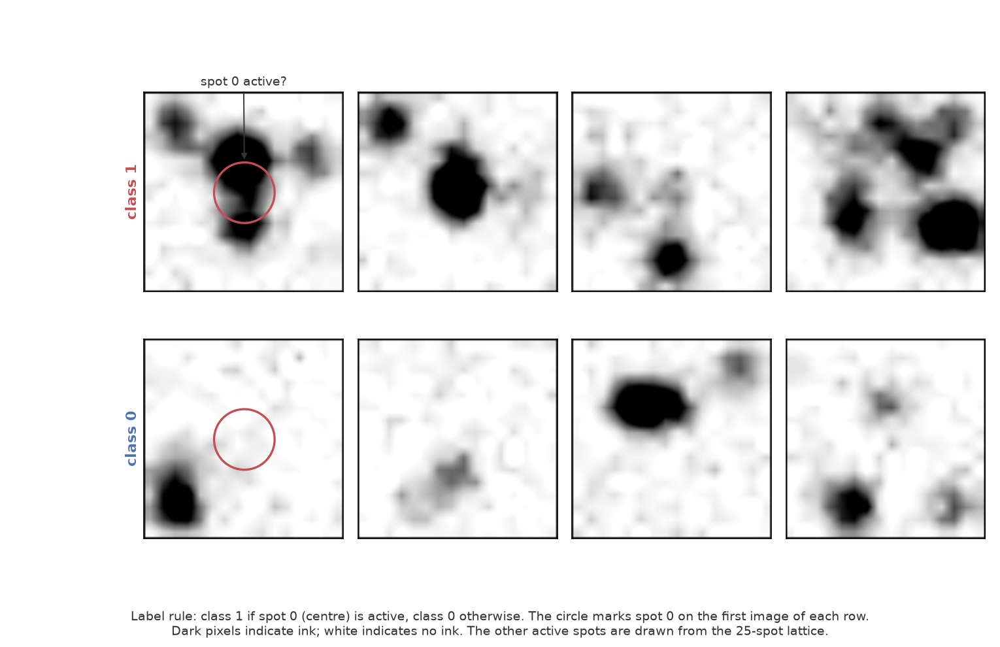
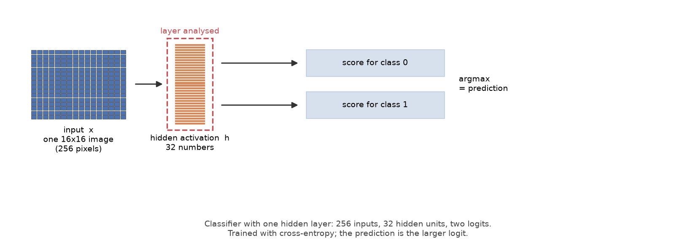
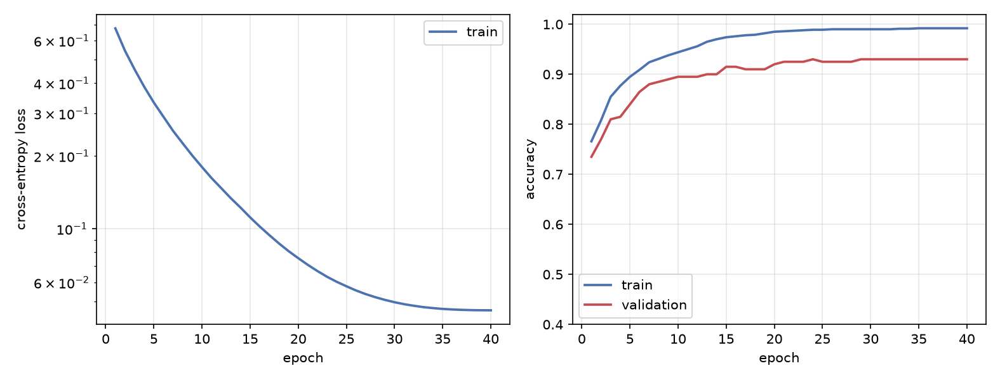
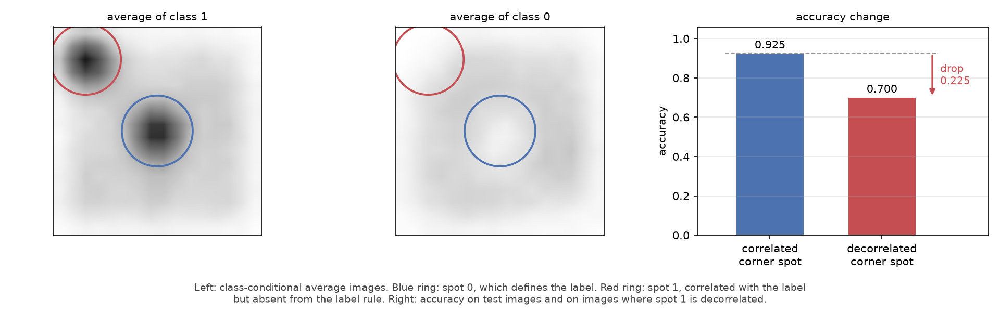
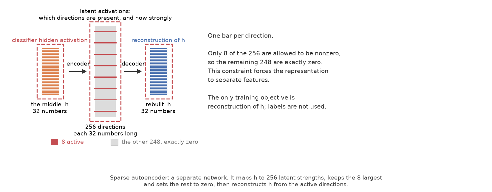
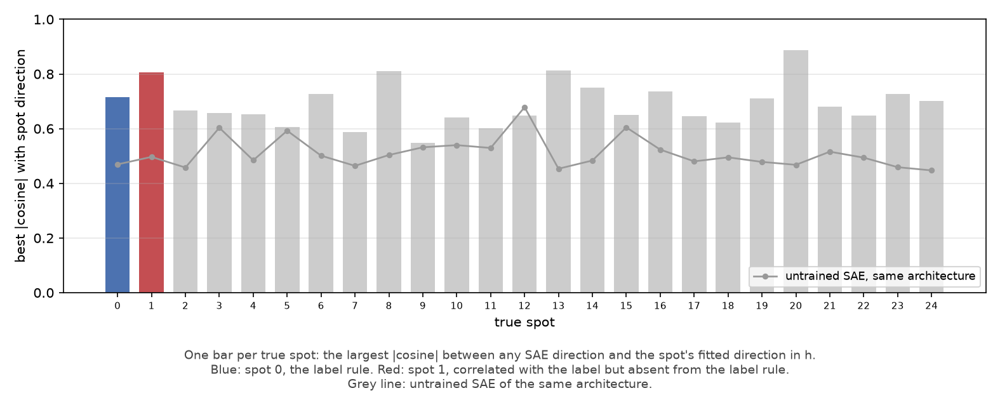
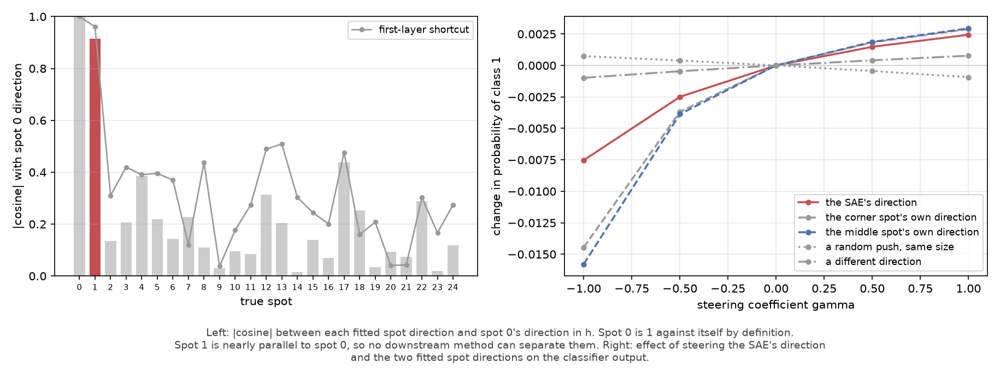
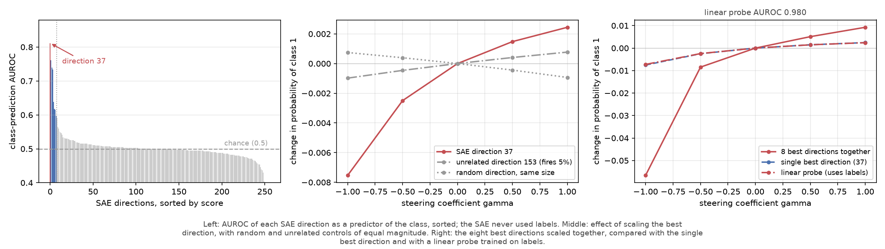

# SAE for a spot classifier

This folder contains three analyses of one synthetic dataset:

1. **Classifier.** A small network maps each image to two logits; the label is determined by
   one active spot.
2. **Sparse autoencoder (SAE).** A second network is trained on the classifier's hidden
   activation `h`, without labels, to reconstruct it from a sparse set of directions.
3. **Steering.** The SAE directions are scored as class predictors, and the leading
   direction is scaled to measure its causal effect on the classifier output.

All numbers and figures are produced by the scripts in this folder. Repeated runs can differ
in the last one or two digits because floating-point summation order is not fixed.

Commands below run from this folder, using the environment at the repository root:

```bash
cd classifier_sae/project_1
PY=../../.venv/bin/python
```

Each script reads the outputs of the preceding one. The classifier and SAE are trained once
and read back by the later scripts (`--model-dir` is the same throughout); the SAE reads `h`
through a forward hook, so training it never changes the classifier. The full pipeline runs
in under a minute on CPU.

## Data

Each image is **16 × 16 pixels**; ink is dark and the background is white. An image is
generated by activating a subset of 25 fixed spots, each with a positive random strength,
and summing their Gaussian profiles. `generate_data.py` builds the dataset and writes
`data/dataset.pth` (images, labels, true spot strengths, and the counterfactual split) plus
one PNG per example under `data/pngs/`:

```bash
$PY generate_data.py --out data
```

The label rule uses one spot:

* **class 1**: spot 0, at the centre of the image, is active;
* **class 0**: spot 0 is not active.

No other spot enters the label rule.



The two rows show four test images per class. The figure is produced by `make_fig1.py`, which
reads the example PNGs:

```bash
$PY make_fig1.py --data data/dataset.pth --pngs data/pngs --out figures/sign
```

Because the images are synthetic, the true spot strengths are known and can be used to
evaluate any direction found later. Two parameters are useful for further experiments:

* **image size**: add `--rows 32 --cols 32` to `generate_data.py`. The classifier, the SAE,
  and every figure take their sizes from the dataset;
* **the conjunction task**: add `--task conjunction` to `generate_data.py`. The label then
  requires spots 0 and 1 to be active together, and no straight line through pixel space
  separates the classes. Use different `--model-dir` and `--figures` folders so the two runs
  do not overwrite each other.

## 1. Classifier

The classifier maps the 256 pixels to **32 hidden units** (`h`), then to **2 logits**. The
prediction is the larger logit.



It is trained with cross-entropy and Adam; the epoch with the best validation accuracy is
retained. `train_classifier.py` writes `model/classifier.pt`, `model/history.json`, and
`model/metrics.json`, and generates the training, architecture, and decoy figures:

```bash
$PY train_classifier.py --data data/dataset.pth --model-dir model --figures figures/sign
```



Test accuracy is **0.925** (validation 0.930).

## 1b. A feature outside the label rule

The data contain a second structured spot: spot 1, in the top-left corner. It is active with
probability 0.995 when the label is 1 and 0.005 when the label is 0, so its presence agrees
with the label **99.5%** of the time, against 50% by chance. It uses the same positive random
strength distribution as the centre spot but does not enter the label rule. It is therefore
a feature present in the data and predictive of the class, but absent from the specification
of the task.



The class-conditional averages differ at spot 0, as the label rule requires, and also at
spot 1. The class-conditional mean strength differs by **0.795** at spot 0 and **0.823** at
spot 1 (ratio 1.03). The classifier uses both: when spot 1 is redrawn independently of the
label, accuracy falls from **0.925 to 0.700**, a drop of **0.225**. This drop is the reference
quantity for the later analyses.

## 2. Sparse autoencoder

### Motivation

The 32 numbers in `h` form a mixed representation of the input features. The SAE is a second
network trained to decompose `h` into a sparse set of directions.

### Architecture

The SAE has a dictionary of **256 directions**, each a vector of 32 numbers, the same
dimension as `h`.

* **encoder**: maps `h` to 256 latent strengths;
* **decoder**: reconstructs `h` as a weighted sum of the directions.

Two constraints define the model:

1. **Sparsity.** Exactly **8** of the 256 latent strengths are kept; the other 248 are set to
   zero. This constraint forces the representation to separate features rather than
   distribute each feature over many directions.
2. **Reconstruction objective.** The loss is the squared error between the reconstruction and
   `h`. Labels are not used.



`train_sae.py` trains the SAE on `h` without labels and writes `model/sae.pt`,
`model/sae_history.json`, and `model/sae_metrics.json`:

```bash
$PY train_sae.py --data data/dataset.pth --model-dir model --figures figures/sign \
                 --n-latent 256 --k 8
```

### Results

| metric | |
|---|---|
| variance of `h` explained | **0.964** train, 0.907 test |
| active latents per example | 8, as constrained |
| dead latents | **0** of 256 |
| alignment with the true spots (mean best cosine) | **0.690** |
| the same, for random directions | 0.505 |

The last two rows test whether the learned directions align with the known generating
features. For each of the 25 spots, the spot's direction in `h` is fitted from the true spot
strengths: it is the direction in which `h` changes when that spot receives more ink. This
fitted direction is compared with all 256 SAE directions, the largest absolute cosine is
retained, and the 25 values are averaged.

The mean best cosine is **0.690**: for the average spot, the closest SAE direction shares
about 69% of its direction with the fitted spot direction. The random baseline is **0.505**,
not zero: with 256 candidate directions, the largest cosine with any given spot is already
about 0.5 by chance. The comparison is therefore 0.690 against 0.505, not 0.690 against zero.

`interpret.py` fits the spot directions in `h`, runs the recovery test, and measures the
steering effect. It writes `model/interpret.json` and the recovery and steering figures:

```bash
$PY interpret.py --data data/dataset.pth --model-dir model --figures figures/sign
```



The figure reports the same measurement per spot. Each bar is the best alignment reached by
any SAE direction. Blue is spot 0 (the label rule); red is spot 1 (correlated with the label
but outside the label rule); grey bars are background spots. The grey line is the same
measurement for an untrained SAE of the same architecture. A bar above that line is evidence
of alignment beyond chance.

The SAE exceeds the baseline on almost every spot. The two structured spots score **0.715**
and **0.805**, against **0.469** and **0.497** for the untrained SAE. These values are above
the mean of 0.690 because the mean includes the 23 background spots.

### Which latent predicts the class?

Each of the 256 latent strengths is scored as a predictor of the class by **AUROC**: 0.5 is
chance, 1.0 is perfect. The best latent is **37**, at **0.812**. It was selected without
labels.

A confound limits the interpretation. Each spot's direction in `h` was fitted as above, and
the absolute cosine with spot 0's direction is:

| direction in `h`, against spot 0's | cosine |
|---|---|
| spot 1 (the correlated corner spot) | **0.914** |
| background spots, mean | 0.161 |
| background spots, maximum | 0.438 |

Spots 0 and 1 are nearly the same direction in `h`. The classifier was trained on images in
which the two spots co-occur, so it never needed to separate them, and it did not. This is a
property of the classifier and is measurable before any SAE is involved.

It also determines what any latent can represent: no latent can be specific to spot 1 and
not to spot 0, because the two spots occupy nearly the same direction.

The SAE dictionary reflects this:

| feature | best-matching latent | cosine | untrained SAE baseline |
|---|---|---|---|
| spot 0 (the label rule) | **157** | **0.715** | 0.469 |
| spot 1 (outside the label rule) | **157** | **0.805** | 0.497 |

The same latent is best for both. The supported conclusion is:

> The SAE's best direction for spot 1 has cosine 0.805 with the fitted spot direction,
> against 0.497 for an untrained SAE of the same architecture. The SAE therefore represents
> the correlated feature. It does not represent it as a direction separate from spot 0,
> because in `h` the two are not separate.



The left panel shows the absolute cosine between each fitted spot direction and spot 0's.
Spot 1 is nearly parallel to spot 0 (0.914); the largest background value is 0.438. The right
panel shows the effect of scaling the direction, treated next.

### Steering: effect of a direction

The direct test is to scale one latent's strength and measure the change in the probability
of class 1.

| `γ` | SAE latent 37 | spot 1 direction | spot 0 direction | random direction, same size | unrelated direction 153 |
|---|---|---|---|---|---|
| −1.0 | −0.0075 | −0.0145 | −0.0158 | +0.0007 | −0.0010 |
| −0.5 | −0.0025 | −0.0037 | −0.0039 | +0.0004 | −0.0005 |
| 0.0 | 0.0000 | 0.0000 | 0.0000 | 0.0000 | 0.0000 |
| +0.5 | +0.0015 | +0.0018 | +0.0019 | −0.0004 | +0.0004 |
| +1.0 | +0.0024 | +0.0029 | +0.0029 | −0.0009 | +0.0008 |

Three observations:

* **The direction has a nonzero effect.** The response is monotonic in `γ` and reverses sign,
  and switching the direction off (`γ = −1`) produces the largest change.
* **Spots 0 and 1 produce nearly identical curves.** This is consistent with their cosine of
  0.914; the measurement cannot distinguish them.
* **The controls are small.** A random direction of equal magnitude changes the answer by at
  most 0.0009. Direction 153 fires on 5% of the images, has AUROC 0.496, and changes the
  answer by at most 0.0010. The effect is therefore specific to the direction, not to
  perturbing `h`.

At `γ = 0`, the new `h` differs from the old `h` by **1.2 × 10⁻⁷**, which is zero up to
single-precision rounding.

### First-layer shortcut

A common shortcut for interpreting a direction is to push the spot template through the
classifier's first layer and treat the result as the spot's direction. This ignores the GELU
nonlinearity between the input and `h`. The shortcut gives a cosine of **0.961** between
spots 1 and 0, whereas the fitted directions give **0.914**. The fitted value is the one used
throughout.

## 3. Steering workflow

This section applies the SAE. The procedure is the standard one used to evaluate SAE
directions:

1. score every direction against a target quantity and retain a shortlist;
2. measure what the leading direction follows, using known spot strengths;
3. scale it in both directions, with a null check at zero;
4. apply the same magnitude of perturbation along control directions;
5. test whether the effect is concentrated in one direction, using a group of directions and
   a linear probe.

`steer.py` performs all five. It writes `model/steering.json` and the figure below:

```bash
$PY steer.py --data data/dataset.pth --model-dir model --figures figures/sign
```



### 1. Scoring directions

The SAE never sees labels, so its directions are unnamed. Each direction's activation is
scored by AUROC as a predictor of the class.

| | |
|---|---|
| best direction | **37** |
| its AUROC | **0.812** |
| directions above 0.70 | **4** of 256 |
| eight best, with AUROC | **37** (0.81), 83 (0.76), 202 (0.74), 51 (0.73), 35 (0.64), 157 (0.62), 161 (0.62), 74 (0.60) |

The left panel of the figure shows all 256 scores in descending order. One direction is
clearly ahead; four exceed 0.70.

Direction **157**, the best-aligned direction for spot 1 in Section 2, is sixth in this
ranking. Direction **37**, the leader, is the direction that follows both spots. It fires on
**32%** of the images and correlates with the true spot strengths at **+0.801** (spot 1) and
**+0.707** (spot 0); the largest background correlation in magnitude is **−0.154**. This is
the same direction identified in Section 2 by a different criterion.

### 2. Steering operation

Every push in this folder uses the same operation. The SAE represents `h` as

$$h = \operatorname{decoder}(z) + r,$$

where `z` is the vector of latent strengths and `r` is the residual. To scale direction *c*
by `γ`, multiply only `z_c` by `(1 + γ)` and reconstruct:

$$h_{\text{new}} = \operatorname{decoder}(z \text{ with } z_c \text{ scaled}) + r.$$

`γ = 0` is no change, `γ = +1` increases the strength by half, and `γ = −1` sets the direction
to zero.

The residual `r` is added back so that the measured change contains only the effect of
scaling `z_c`, not the SAE's reconstruction error. The residual variance is the 9.3% of the
variance of `h` that the SAE does not reconstruct on the test split (variance explained
0.907).

**Null check.** At `γ = 0`, the reconstructed `h` differs from the original by
**1.2 × 10⁻⁷**. Changes reported below are therefore attributable to the scaling operation.

### 3. Steering and controls

Change in the probability of class 1. Both controls receive the same per-image magnitude as
the real direction.

| `γ` | SAE direction 37 | unrelated direction 153 | random direction, same size |
|---|---|---|---|
| −1.0 | **−0.0075** | −0.0010 | +0.0007 |
| −0.5 | −0.0025 | −0.0005 | +0.0004 |
| 0.0 | 0.0000 | 0.0000 | 0.0000 |
| +0.5 | +0.0015 | +0.0004 | −0.0004 |
| +1.0 | **+0.0024** | +0.0008 | −0.0009 |

Three observations:

* **The effect is monotonic and reverses sign.** Increasing `γ` raises the output, decreasing
  it lowers the output, and `γ = −1` produces the largest change.
* **The controls are small.** Both control curves stay within **0.001** of zero at every
  `γ`, so the effect depends on the direction rather than on perturbing `h`.
* **The control direction is active.** Direction 153 fires on 5% of the images and has AUROC
  0.496, so its null effect is not due to a latent that is always zero. The threshold is
  `CONTROL_MIN_FIRING` in `steer.py`.

### 4. The effect is distributed across directions

Direction 37 is not the only contributing direction. Scaling the **eight best directions
together** changes the output by **+0.0093** at `γ = +1.0`, against **+0.0024** for direction
37 alone (ratio 3.8). At `γ = −1.0`, the group changes it by **−0.0566**.

### Comparison with a linear probe

A linear probe fitted on labels is a stronger detector on this task: AUROC **0.980** against
**0.812**, and **1.000** against **0.875** when restricted to images on which direction 37
fires.

For steering, the two are nearly identical: **+0.0024** at `γ = +1.0` for both, and
**−0.0075** against **−0.0073** at `γ = −1.0`. The class boundary is close to linear in `h`,
so the probe is the sharper read-out; it uses labels that the SAE never receives. The SAE
provides an unlabelled ranking of 256 directions, and a group of directions that steers more
strongly than any single one.

## Files

| step | file | contents |
|---|---|---|
| n/a | [generate_data.py](generate_data.py) | synthetic dataset: spots, labels, the correlated feature, and the counterfactual split |
| 1 | [train_classifier.py](train_classifier.py) | the classifier (`Classifier`), training, the step-1 figures, and the decorrelation test |
| 2 | [train_sae.py](train_sae.py) | the sparse autoencoder (`SparseAutoencoder`), extraction of `h`, and the alignment check |
| 2 | [interpret.py](interpret.py) | fitted spot directions in `h`, the recovery test, and the steering experiment |
| 3 | [steer.py](steer.py) | direction scoring, steering, controls, the direction group, and the linear probe |
| n/a | [make_fig1.py](make_fig1.py) | the data figure, assembled from the example PNGs |

## Summary

* The classifier reaches test accuracy **0.925**. Its label rule depends on spot 0 only.
* Spot 1 is correlated with the label and costs **0.225** accuracy when decorrelated.
* The SAE explains **0.907** of the variance of `h` on test and recovers directions aligned
  with the true spots: mean best cosine **0.690**, against **0.505** for a random dictionary
  of the same size.
* The SAE represents spot 1 (cosine **0.805**, against 0.497 for an untrained SAE), but with
  the same direction as spot 0, because the two spots are nearly parallel in `h` (cosine
  **0.914**). The data do not support separate representations of the two spots.
* Scaling direction 37 changes the class-1 probability monotonically, from **−0.0075** at
  `γ = −1.0` to **+0.0024** at `γ = +1.0`. Equal-magnitude control perturbations remain
  within **0.001** of zero.
* The effect is distributed: the eight best directions together produce **+0.0093** at
  `γ = +1.0`. A linear probe is a stronger detector (AUROC **0.980** against 0.812) and
  produces the same steering effect at `γ = +1.0`.
