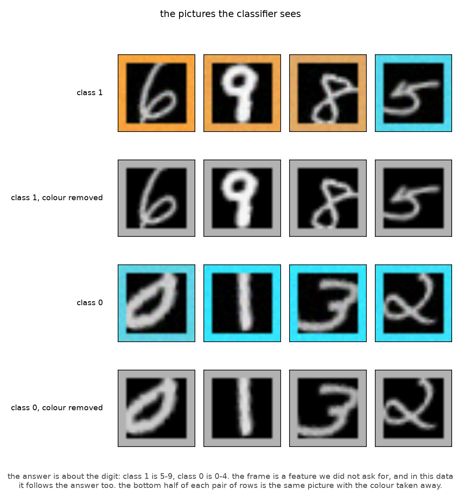
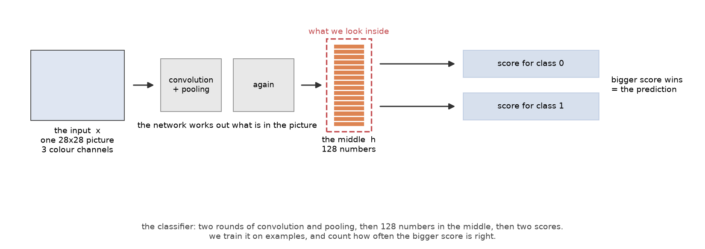
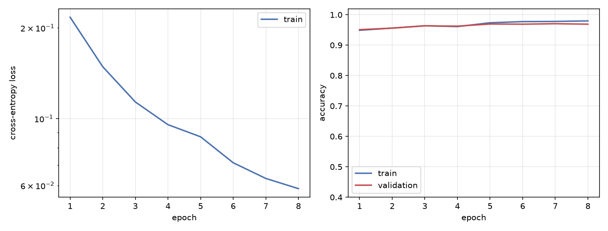
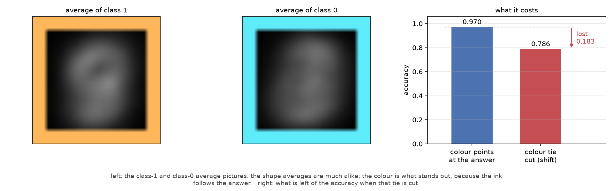
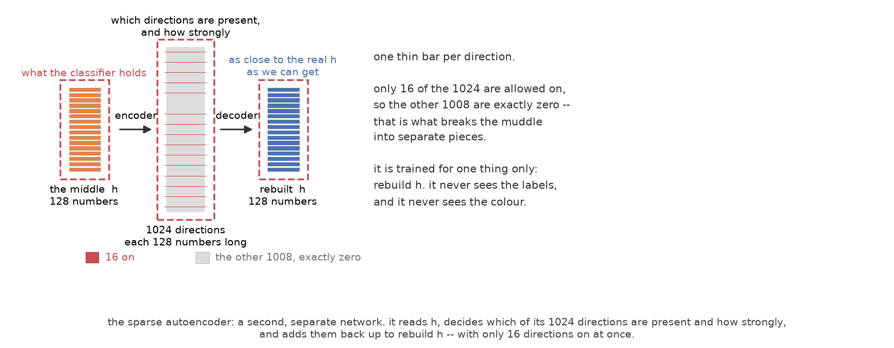
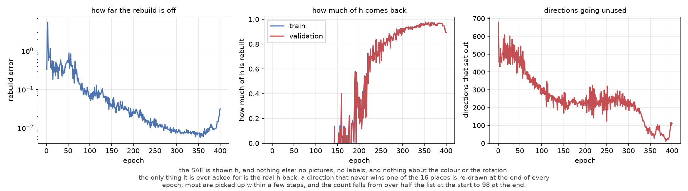
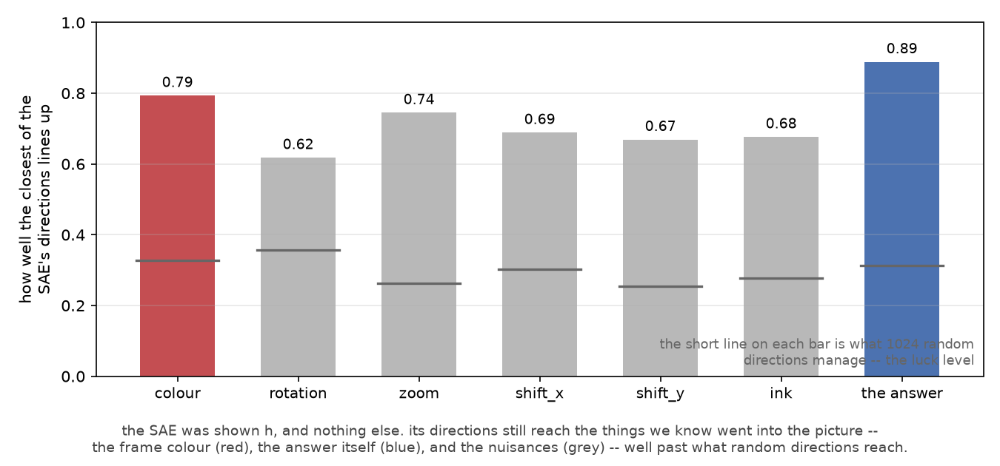
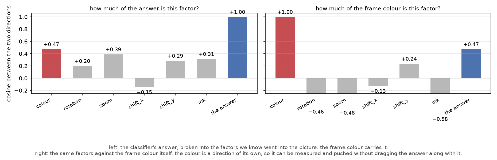
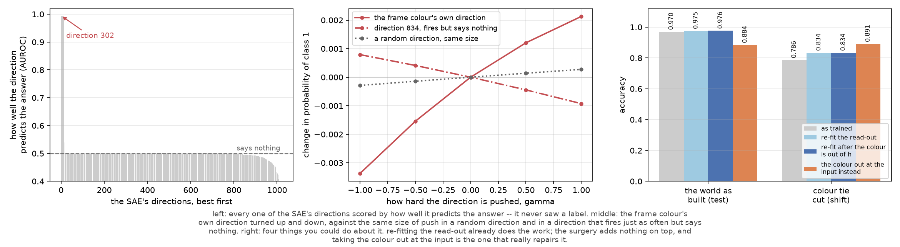

# SAE for an MNIST digit classifier

## Summary

A small convolutional network is trained to classify MNIST digits as *high* (5–9) or *low*
(0–4). Every image is presented inside a 3-pixel coloured border whose hue is correlated with
the label: it agrees with the answer 95% of the time in the training distribution. The border
is not the label and the label cannot be computed from it, but it is a reliable predictor of
the label that is available in every image, and the network uses it in addition to the
digit's shape. Accuracy falls from **0.970** to **0.786** when the correlation is removed at
test time.

A TopK sparse autoencoder (SAE, 1024 latents, k = 16) is trained with no labels and no images
to reconstruct `h`, the classifier's 128-dimensional penultimate activation (GELU output of
`body.8`). It is then used to locate the shortcut, test it causally, flag individual
predictions that depend on it, and attempt a repair.

Main results:

| # | result | measurement |
|---|---|---|
| 1 | the SAE recovers every factor of the generative model from `h` alone | mean best cosine **0.752**, against **0.296** for random directions |
| 2 | one latent, selected without labels, reads the frame hue | latent **302**, AUROC **0.994** (r = **+0.91**); still **0.834** on the decorrelated split, where the hue carries no class information |
| 3 | the shortcut is causally implicated | removing the colour direction changes **17%** of test predictions; same-size random and unrelated controls change **0.000** and **0.002** |
| 4 | the same intervention is a usable per-example monitor | flags **26%** of the decorrelated split, where accuracy is **0.699** against **0.817** elsewhere |
| 5 | repair: re-fitting the read-out recovers most of the lost robustness | decorrelated accuracy **0.786 → 0.834** |
| 6 | repair: surgery on `h` adds nothing | **0.834** with or without it; the colour stays fully decodable from `h` afterwards (AUROC **1.000**) |
| 7 | repair: the input is the effective place to intervene | decorrelated accuracy **0.891**, at a cost of **0.086** on the original split |

All numbers are produced by the scripts in this folder; the commands are given in each
section. Figures are in `figures/`, and every recorded measurement is in `model/*.json`.

Commands run from this folder with the repository environment:

```bash
cd classifier_sae/project_2
PY=../../.venv/bin/python
```

## 1. Task and data

### 1.1 Classification task

Inputs are MNIST digits, 28 × 28, three channels (white ink on a black page). The label is
binary:

* **class 1** — the digit is 5, 6, 7, 8 or 9;
* **class 0** — the digit is 0, 1, 2, 3 or 4.

The label is a function of the digit's shape only. `generate_data.py` builds the dataset,
caches MNIST under `data/mnist/`, and writes `data/dataset.pth`:

```bash
$PY generate_data.py --out data
```

### 1.2 The spurious feature

Each image is built from two parts that are generated independently: the digit, drawn as
white ink on a black page, and a flat-coloured frame painted over the outer 3 pixels. The hue
is drawn from the label's hue with probability `0.5 + 0.5 · c` for a correlation parameter
`c`, and from the other hue otherwise. The default is `c = 0.9`, i.e. agreement **0.95**.

Two construction details are required for the measurements in §3 to be meaningful:

* the frame is painted **around** the digit, never over it, so the colour and the shape occupy
  disjoint regions of the input and neither masks the other;
* both hues are scaled to the **same luminance** (0.70), so the two inks differ in hue only. A
  classifier that reads the frame cannot be reading brightness, and a greyscale rendering of
  an image carries no information about its frame hue.

Colour strength varies per image (`chroma ~ U(0.6, 1.0)`, blending the hue towards the shared
grey) and is recorded.

### 1.3 Recorded generative factors

Five nuisances are applied to every digit, drawn independently of the label and of each
other, and each is **recorded**:

| factor | distribution | note |
|---|---|---|
| `rotation` | U(−20°, +20°) | applies to the digit only |
| `zoom` | 1 + U(−0.2, +0.2) | scale about the centre |
| `shift_x`, `shift_y` | U(−0.15, +0.15) | fraction of half the image width |
| `ink` | U(0.70, 1.00) | multiplicative gain on the stroke |
| `colour` | ±U(0.6, 1.0) | signed chroma; sign = hue, magnitude = saturation |

Gaussian pixel noise (σ = 0.02) is added and the result is clipped to [0, 1]. The dataset
therefore carries, for every image, the exact value of all six factors that produced it. This
is what allows the SAE's directions to be checked against ground truth rather than described.

### 1.4 Splits

| split | n | frame agrees with the answer |
|---|---|---|
| `train` | 12000 | 0.949 |
| `val` | 2000 | 0.951 |
| `test` | 2000 | 0.948 |
| `shift` | 2000 | 0.518 |

`train` draws from the MNIST training set; `val`, `test` and `shift` draw from the MNIST test
set, so nothing reported below was trained on. `shift` uses the same generative process with
`c = 0`: the hue is a coin flip, independent of the label. The digits, nuisances, noise and
marginal colour distribution are identical, so `shift` isolates the loss of the correlation.



*Four examples per class (top row of each pair), and the same four images with the frame
painted grey (bottom row).*

The figure is produced by `make_fig1.py`:

```bash
$PY make_fig1.py --data data/dataset.pth --out figures
```

Parameters varied in this report, all flags on `generate_data.py`:

| flag | default | effect |
|---|---|---|
| `--correlation c` | 0.9 | hue agrees with the answer `0.5 + 0.5c` of the time; `0` removes the shortcut, `0.95` raises the cost of §2.2 to approximately 0.28 |
| `--frame` | 3 | frame thickness in pixels; `1` makes it a thin line |
| `--max-rotation`, `--jitter-scale`, `--jitter-shift` | 20, 0.2, 0.15 | nuisance strength; larger values weaken the shape signal and shift the balance between the two features |

## 2. Classifier

### 2.1 Architecture and training

| | |
|---|---|
| input | 3 × 28 × 28, standardised by the train mean and standard deviation |
| body | `Conv2d(3→16, 3×3) → ReLU → MaxPool2d(2)` → `Conv2d(16→32, 3×3) → ReLU → MaxPool2d(2)` → `Flatten` → `Linear(1568→128)` → `GELU` |
| head | `Linear(128→2)` |
| `h` | the GELU output, 128-dimensional (`body.8`), read by a forward hook |
| optimiser | Adam, lr 1e-3, weight decay 1e-4, batch 128, cosine schedule, 8 epochs |
| selection | epoch with the highest validation accuracy (epoch 7) |

`train_classifier.py` trains the network and writes `model/classifier.pt`,
`model/history.json`, and `model/metrics.json`, plus the architecture, training, and shortcut
figures:

```bash
$PY train_classifier.py --data data/dataset.pth --model-dir model --figures figures
```



*Classifier. Pixels → two convolution/pooling rounds → `h` (128 numbers) → two scores.*



*Training: cross-entropy loss and accuracy per epoch; the retained epoch is the best by
validation accuracy.*

### 2.2 Result

| split | accuracy |
|---|---|
| train | 0.978 |
| validation | 0.971 |
| **test** (`c = 0.9`) | **0.970** |
| **shift** (`c = 0`) | **0.786** |
| shift, frame painted grey | 0.891 |

The classifier is never told that a frame exists. If it used shape only, the `test` and `shift`
accuracies would coincide; they differ by **0.183**. That difference is the part of its accuracy
attributable to the correlation, and it is the quantity §4.5 attempts to recover.

The last row gives the shape-only ceiling under this measurement: with the frame neutralised at
the input, the same trained network reaches 0.891 on the decorrelated split.



*Left, centre: class means. The shape means are similar; the difference between them is
dominated by the frame hue. Right: accuracy with and without the correlation.*

## 3. Sparse autoencoder

### 3.1 Architecture and training

A TopK SAE with a 1024-row dictionary over `h` (128-dimensional):

| | |
|---|---|
| encoder | `Linear(128→1024)`, applied to `h − b_dec`, followed by ReLU |
| sparsity | the 16 largest pre-activations are kept; the other 1008 are set to exactly 0 |
| decoder | `Linear(1024→128)`, columns constrained to unit norm after every step |
| objective | mean squared error against `h`; no labels, no images |
| optimiser | Adam, lr 1e-3, batch 256, cosine schedule, 400 epochs |
| dead-latent handling | latents that never win a top-k slot in an epoch are re-initialised from the reconstruction residual of one example at the end of that epoch |

`train_sae.py` trains the SAE on `h` and writes `model/sae.pt`, `model/sae_history.json`,
and `model/sae_metrics.json`, plus the SAE figures:

```bash
$PY train_sae.py --data data/dataset.pth --model-dir model --figures figures \
                 --n-latent 1024 --k 16
```



*Sparse autoencoder. `h` is encoded into 1024 strengths of which 16 are non-zero, and those
directions are summed to reconstruct `h`.*

### 3.2 Reconstruction

| metric | |
|---|---|
| variance of `h` explained — train | 0.895 |
| — validation | 0.893 |
| — test | 0.895 |
| — shift | 0.885 |
| active latents per image | 16 (enforced) |
| latents that never activate on the training data | 98 / 1024 |
| mean best cosine against the seven known directions | **0.752** |
| the same, for 1024 random directions | 0.296 |

Two hyperparameter settings matter and were chosen by measurement: lr 3e-3 diverges at this
dictionary size, and a 200-epoch run collapses in its final epochs (reported reconstruction
0.76), so lr 1e-3 for 400 epochs is used.



*SAE training: reconstruction error, fraction of `h`'s variance explained, and the number of
latents that failed to activate in each epoch (re-initialised at the end of every epoch).*

### 3.3 Estimating a factor's direction in `h`

Let `u_f` denote the direction in `h` corresponding to factor `f`. Two estimators were
considered.

**Regression.** Regress `h` on the table of true factor values (multivariate least squares) and
take the rows of the solution. This is unreliable here, and the failure is silent. `h` is a
small vector whose variance is dominated by the answer, so a factor with a weak true effect
receives a fitted direction determined mostly by whatever else the fit can absorb. On this
model the fitted colour direction has cosine **0.937** with the classifier's decision direction
(`w = W₁ − W₀` of the head), whereas the true value is 0.47; and adding a single **pure-noise**
column to the table and re-fitting yields a "factor direction" whose cosine with `w` has
magnitude 0.69, 0.77 and 0.77 for three fixed seeds. The estimator is not usable at this
signal-to-noise ratio.

**Paired intervention** (used throughout). For factor `f`, take the source digit and the full
factor row of image `i`, render the image twice with only that factor changed by ±Δ (identical
noise field in both renders), and difference the activations:

$$u_f \;=\; \mathrm{normalise}\!\left(\frac{1}{N}\sum_{i=1}^{N}
\bigl[\,h(a_i + \Delta e_f) - h(a_i - \Delta e_f)\bigr]\right)$$

with `N = 1000` source images, and the mean norm of the bracketed term reported as the
*factor's effect size* on `h`. The steps used are Δ = 0.35 (colour), 8° (rotation), 0.12 (zoom),
0.08 (shift), 0.12 (ink).

Two properties of this estimator support its use here. First, rendering the same image twice
gives a difference of exactly **0** (no noise floor). Second, because the factors are
independent by construction, each intervention changes one factor and nothing else, so the
estimate is not affected by the correlations that break the regression.

`interpret.py` computes the intervention directions and the recovery measurements, and writes
`model/interpret.json` plus the recovery and direction figures:

```bash
$PY interpret.py --data data/dataset.pth --model-dir model --figures figures
```

### 3.4 Geometry of the factors in `h`

| factor | effect size ‖Δh‖ | cos with the answer direction | cos with the colour direction |
|---|---|---|---|
| **colour** (shortcut) | 1.84 | **+0.47** | +1.00 |
| rotation | 1.86 | +0.20 | −0.46 |
| zoom | 2.05 | +0.39 | −0.48 |
| shift_x | 1.99 | −0.15 | −0.13 |
| shift_y | 2.02 | +0.29 | +0.24 |
| ink | 1.71 | +0.31 | −0.58 |
| **answer** | | +1.00 | **+0.47** |

The direction that carries the classifier's answer is approximately half aligned with the frame
colour. The colour is nevertheless separable: its cosine with any nuisance is at most 0.58, and
0.47 with the answer. This is the property §4.5 depends on — had the colour and the answer been
the same direction in `h`, no downstream method could have separated them.

### 3.5 Recovery of the known directions

For each of the seven known directions (six factors, plus the answer direction, i.e. the
difference of the class means of `h` on the training split), the report is the largest absolute
cosine between it and any of the SAE's 1024 directions. The comparison is against 1024 random
directions, evaluated by the same statistic: with that many candidates, a high maximum is
expected by chance, and that chance level is the relevant baseline.



*Best alignment between each known direction in `h` and the SAE's 1024 directions (bars); the
short line on each bar is the same statistic for 1024 random directions.*

| known direction | best of the SAE's 1024 | latent | random-directions baseline |
|---|---|---|---|
| **colour** (shortcut) | **0.793** | 896 | 0.329 |
| rotation | 0.618 | 772 | 0.357 |
| zoom | 0.745 | 950 | 0.263 |
| shift_x | 0.689 | 823 | 0.303 |
| shift_y | 0.669 | 226 | 0.254 |
| ink | 0.676 | 271 | 0.277 |
| **answer** | **0.888** | 302 | 0.312 |

The SAE exceeds the baseline on all seven, with a mean margin of **0.426** (0.726 against 0.299).
The dictionary therefore contains directions aligned with every known factor of the data,
although the alignment is partial: the best match for the colour is 0.793, not 1.0.



*Left: cosine between each factor's direction and the answer direction. Right: cosine between
each factor's direction and the colour direction.*

## 4. Auditing the classifier

Sections 4.1–4.5 correspond to the steps in `audit.py`, which writes `model/audit.json` and
the audit figure:

```bash
$PY audit.py --data data/dataset.pth --model-dir model --figures figures
```

### 4.1 Ranking the latents by class prediction

Each latent's activation is scored against the label by AUROC on `val ∪ test` (4000 images not
used to train the SAE). The SAE itself required no labels; this step uses the classifier's
labels, which are already available.

| | |
|---|---|
| best direction | **302** |
| its AUROC | **0.995** |
| directions above 0.700 | **16** of 1024 |
| top ten (direction, AUROC) | 302 (0.995), 981 (0.995), 633 (0.994), 387 (0.994), 971 (0.994), 881 (0.994), 8 (0.993), 764 (0.993), 341 (0.993), 804 (0.992) |
| latent 302 firing rate | 0.65 |

### 4.2 Identifying the shortcut

Latent 302 is tested against the frame hue, which the SAE was never given:

| measurement | value |
|---|---|
| AUROC for hue, on `val ∪ test` | **0.994** |
| correlation with the recorded chroma | **+0.91** |
| AUROC for hue on `shift`, where hue is independent of the label | **0.834** |
| cosine between the latent's **decoder** direction and the colour direction `u_colour` | **−0.24** |

The third row is the relevant one: the latent continues to detect the hue after the
correlation has been removed, i.e. it reads the feature and not the label. The fourth row is a
caveat developed in §5: the latent is a usable *detector* of the feature, but its decoder
direction is not the feature's direction in `h`.

### 4.3 Causal test

`h` is perturbed along a direction and the change in the probability of class 1 is recorded, on
the test split. The perturbation is one unit of the feature per image,

$$h_{\text{new}} = h + \gamma \bigl[(h - \bar h)\cdot u\bigr]\, u,$$

i.e. the image's own component along `u`, centred on the split mean so that the large constant
offset of `h` is not treated as part of the feature. Both controls receive the same
per-image magnitude, so only the direction differs.

| γ | colour direction | direction 834 (fires, AUROC 0.45) | random direction |
|---|---|---|---|
| −1.0 | **−0.0034** | +0.0008 | −0.0003 |
| −0.5 | −0.0015 | +0.0004 | −0.0001 |
| 0.0 | 0.0000 | 0.0000 | 0.0000 |
| +0.5 | +0.0012 | −0.0004 | +0.0001 |
| +1.0 | **+0.0021** | −0.0009 | +0.0003 |

The magnitudes are small because the classifier is confident and the softmax saturates; the
more discriminative statistic is the number of **discrete predictions** changed by removing the
component altogether (γ = −1):

| removed | share of test predictions changed |
|---|---|
| the colour direction | **0.17** |
| direction 834 (fires at rate 0.05, AUROC 0.45) | 0.002 |
| a random direction | 0.00 |

Control direction 834 is chosen with a minimum firing rate (`CONTROL_MIN_FIRING` in `audit.py`)
so that it is not a no-op for a trivial reason.

Two zero-checks precede these results. Rebuilding `h` at γ = 0 (the SAE's own dial on latent
302) reproduces `h` to **1.2e−07**; a push of zero changes the predicted probability by
**−6.5e−11**.

### 4.4 Per-example monitoring

The same intervention is applied per image: for each image, the colour component is removed
from `h` and the prediction is compared with the unmodified one. A change of prediction
identifies an image whose answer came from the frame rather than from the digit.

| split | flagged | accuracy, flagged | accuracy, unflagged | accuracy, all |
|---|---|---|---|---|
| test | 0.17 | 0.941 | 0.976 | 0.970 |
| **shift** | **0.26** | **0.699** | **0.817** | 0.786 |

On the decorrelated split the flag covers a quarter of the data and separates a subset that is
answered 0.118 worse than the rest.

### 4.5 Repair

Four interventions are measured. The read-out here is the classifier's final `Linear(128→2)`;
"re-fit" means replacing it with an equivalent layer trained on the same training labels
(Adam, lr 0.05, 800 steps), leaving the convolutional body and `h` untouched.

| intervention | test | shift |
|---|---|---|
| none (as trained) | 0.970 | 0.786 |
| re-fit the read-out only | 0.975 | **0.834** |
| remove the colour direction from `h`, then re-fit | 0.976 | **0.834** |
| neutralise the colour at the **input**, then the trained network as-is | 0.884 | **0.891** |
| zero latent 302's contribution, then re-fit | 0.973 | 0.831 |

* **The read-out re-fit accounts for the entire gain.** Re-learning only the read-out, on the same `h`
  and the same labels, moves the decorrelated split from 0.786 to 0.834. The body and `h` are
  untouched, so the improvement comes from the read-out alone: the original head was selected
  for accuracy on a validation split where colour was almost always correct, and a fresh linear
  fit on `h` relies on it less. Which part of that difference (optimisation path, early
  stopping, co-adaptation with the body) is responsible is not separated by this experiment.
* **The intervention on `h` adds no measurable gain.** Removing `u_colour` and re-fitting gives
  the same 0.834. This is verifiable rather than inferred: after the intervention a fresh
  read-out fitted to the hue still decodes it at AUROC **1.000** on the shift split. Removing
  one direction left the feature decodable.
* **The effective intervention is at the input.** Painting the frame grey leaves nothing to
  read and reaches 0.891, equal to the shape-only ceiling measured in §2.2, at a cost of 0.086
  on the original split — the cue removed was genuinely informative there. This requires no
  labels and no retraining, but it does require knowing which feature to remove, which is the
  SAE's contribution.



*Left: the 1024 latents ranked by class AUROC. Centre: causal perturbation of the colour
direction with two same-size controls. Right: the repair candidates of the table above.*

## 5. Limitations

* **A latent can detect a feature without being its axis.** Latent 302 has AUROC 0.994 for the
  frame hue, but its decoder direction has cosine −0.24 with `u_colour`. An encoder direction
  and the decoder direction of the same latent are different objects; the latent is informative
  as a scalar read-out and is not a causal control on the feature.
* **Selecting a latent is not equivalent to removing a feature.** Zeroing latent 302 and
  re-fitting gives 0.831,
  against 0.834 for the direction surgery and 0.834 for no surgery. The colour's effect in `h`
  is nearly one-dimensional (its leading principal direction carries **86.8%** of the energy of
  the per-image colour change) but not exactly, and the residual is sufficient to re-learn the
  colour rule from the training labels.
* **Labels remain a stronger read-out.** A single linear probe through `h` fitted to the hue
  with the labels reaches AUROC **1.000**, against 0.994 for the SAE latent. The SAE's advantage
  is not accuracy: it requires no labels, and it returns a ranked dictionary rather than one
  direction.
* **The repair is an evaluation, not a deployable method.** The decorrelated split is used as
  the evaluation and, in §4.5, the intervention is chosen with knowledge of which feature is
  spurious. A deployment would not have that knowledge confirmed in advance.
* **Scope.** One model, one dataset, one binary task, and a 128-dimensional `h`. The conversion
  from "a latent that detects the feature" to "a direction that can be removed" is the step
  that failed here, and there is no reason to expect it to behave the same way at other widths
  or with other sparsity levels.

## 6. Files

| file | contents |
|---|---|
| `generate_data.py` | the generative model: MNIST, the coloured frame, the nuisances, the recorded factor table, the four splits, and `render()` for redrawing an image with one factor changed |
| `train_classifier.py` | `Classifier`, training, the split metrics, and the greyscale/shift evaluation |
| `train_sae.py` | `SparseAutoencoder` (TopK), `h` extraction by forward hook, dead-latent resampling, first alignment check |
| `interpret.py` | paired-intervention factor directions, the geometry table, and the recovery measurement against the random baseline |
| `audit.py` | latent ranking, shortcut identification, causal test, per-example monitor, and the four repair candidates |
| `make_fig1.py` | the example-image figure, read directly from `data/dataset.pth` |
| `requirements.txt` | `numpy`, `torch`, `matplotlib` |

## 7. Conclusions

1. A small convolutional classifier trained on a distribution where a colour cue is 95%
   correlated with the label reaches 0.970 accuracy, of which 0.183 is attributable to the cue;
   the residue is measurable by decorrelating the cue at test time.
2. A TopK SAE trained only to reconstruct the penultimate activation recovers, without labels
   or images, directions aligned with every recorded factor of the data (mean 0.752 against a
   random-direction baseline of 0.296), and provides a scalar read-out of the spurious hue at
   AUROC 0.994 that does not depend on the correlation.
3. Factor directions must be estimated by intervention, not by regression on the true factor
   values: with `h`'s variance dominated by the answer, the regression estimator attributes
   unrelated variance to weak factors and returns directions aligned with the answer (0.937 for
   the colour; cosine magnitude 0.69–0.77 for pure-noise columns).
4. The shortcut can be removed and the resulting accuracy measured, but the effective
   intervention is not the one the sparse-dictionary picture suggests: re-fitting the read-out
   recovers all of the gain, surgery on `h` recovers none of it beyond that, and neutralising
   the feature at the input recovers the most (0.786 → 0.891) at a measurable cost elsewhere.
