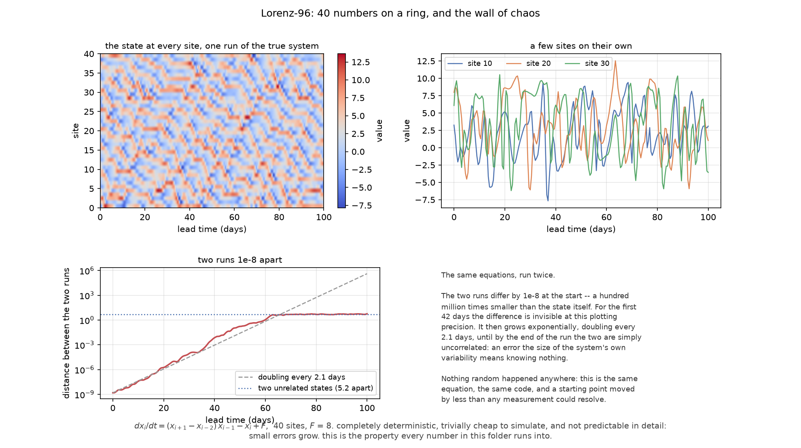
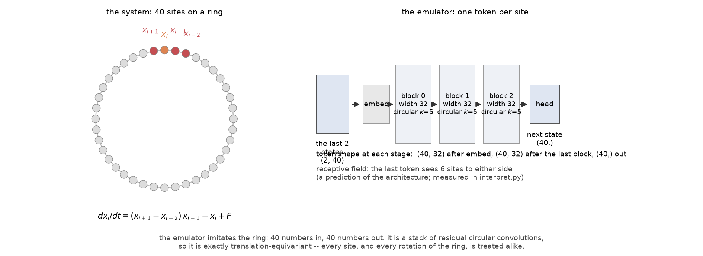
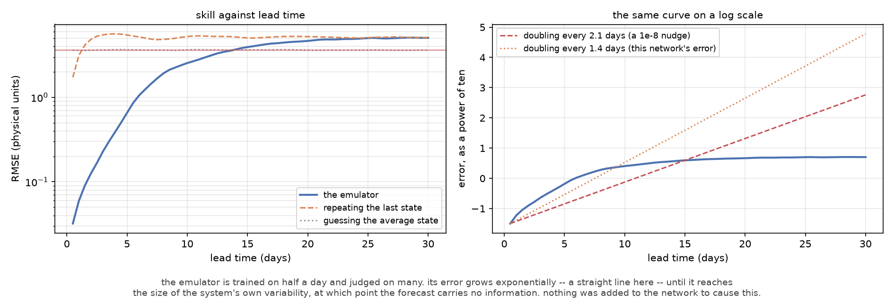
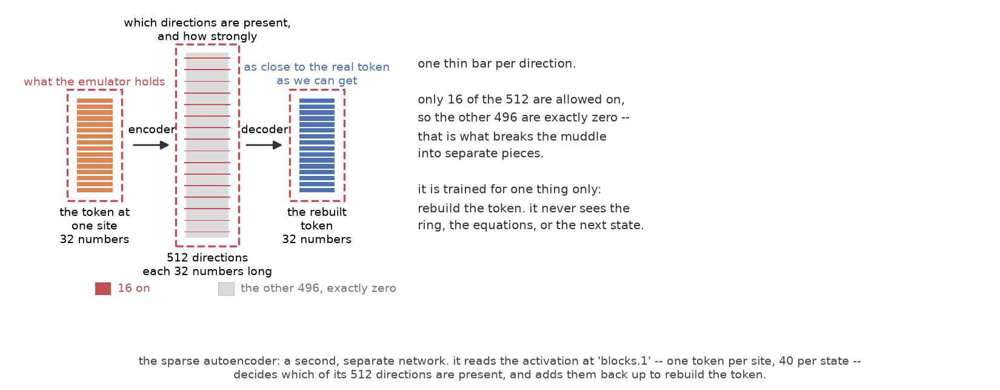
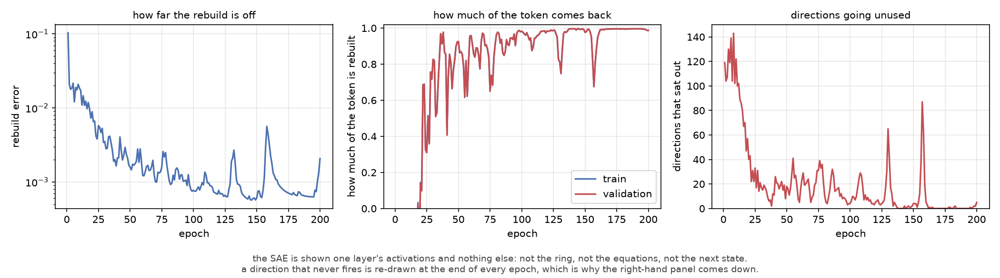
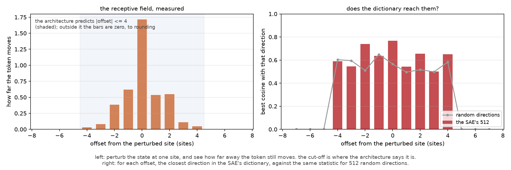
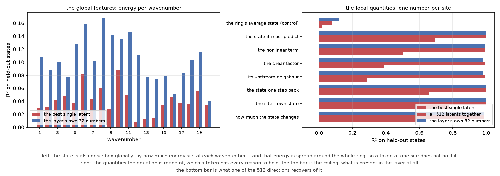
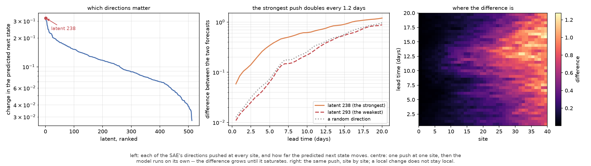

# SAE for a Lorenz-96 emulator

## Summary

A small neural network is trained to imitate Lorenz-96, a chaotic ring of 40 numbers governed
by a single equation. It learns the job well: its one-step error is **1.0%** of the system's
own variability, and it beats the no-skill forecast for the first **13.5 days** of a
free-running rollout.

A TopK sparse autoencoder (SAE, 512 latents, k = 16) is then trained on the emulator's
internal activations with no reference to the ring, the equations or the next state. It
rebuilds **98.7%** of a token's variation, so as a whole it is a faithful re-encoding of what
the layer holds. The question this folder answers is what its *individual* directions
correspond to, and what happens when one of them is pushed.

The standard shortcuts are unavailable here. There is no label to predict and no spurious feature to
hunt: the ground truth is continuous, high-dimensional and *local*, and the system's defining
property — that small differences grow exponentially — means that any perturbation, meaningful
or not, eventually changes everything. Both facts are measured rather than assumed, and both
limit what can be concluded.

Main results:

| # | result | measurement |
|---|---|---|
| 1 | the emulator is worth interpreting | one-step RMSE **0.0356**, which is **1.0%** of the natural variability **3.64**; it beats the no-skill forecast to day **13.5**, and is never worse than repeating the last state at any lead time measured |
| 2 | its errors grow for a reason of the system's, not the network's | forecast error doubles every **1.42 days**, against **2.09 days** for a 1e-8 nudge in the true system |
| 3 | the token's window can be measured, and it matches the architecture | the token at `blocks.1` responds only within **±4 sites**, exactly the predicted support, and the response **is zero** outside it (max `0.0`, not merely small) |
| 4 | the SAE is a faithful re-encoding but not a decomposition | all 512 latents together rebuild the local quantities at R² **0.99**; the best *single* latent reaches only **0.29–0.78** |
| 5 | a dictionary direction is not a privileged description of the physics | best cosine with the perturbation-defined directions **0.625**, against **0.557** for 512 random directions in the same 32 dimensions |
| 6 | the global description of the ring is simply absent from a local token | wavenumber energy is recoverable at R² **0.104** by the layer's own numbers, and **0.041** by the best latent |
| 7 | "effective" and "interpretable" pick out different directions | the latent whose push travels furthest (238) reads the next state at R² **0.005**, the best reader (496) at **0.698**; the two orderings over all 512 directions are uncorrelated (rank correlation **−0.008**, one shared latent in both top tens) |
| 8 | a push does not stay put, and its growth is not a signature | the strongest push starts **5.4×** larger than the weakest and doubles every **1.19 days**; the weakest and a random direction behave alike (1.63 vs 1.58 days) and all three end up at the size of natural variability |

All numbers are produced by the scripts in this folder; the commands are given in each
section. Figures are in `figures/`, and every recorded measurement is in `model/*.json`.

Commands run from this folder with the repository environment:

```bash
cd classifier_sae/project_3
PY=../../.venv/bin/python
```

## 1. The system

### 1.1 Lorenz-96

Lorenz-96 is a ring of $N$ sites with cyclic indices, with one rule per site:

$$\frac{dx_i}{dt} = (x_{i+1} - x_{i-2})\,x_{i-1} - x_i + F$$

Three terms, and each does one job:

* $(x_{i+1} - x_{i-2})\,x_{i-1}$ — the only term that couples sites. A *difference* two sites
  ahead is carried past the site by its upstream neighbour one behind. This is the term that
  lets a disturbance travel, and the reason the equation is asymmetric: site $i-1$ talks to
  $i$ directly, while $i+1$ only talks to $i$ through its own neighbour;
* $-x_i$ — damping, pulling every site back towards the origin;
* $+F$ — constant forcing. The state $x_i = F$ for all $i$ is a fixed point: every site
  satisfies $0 = 0 - F + F$.

The configuration used here is the standard chaotic one, $N = 40$ and $F = 8$. The integration
starts from a random perturbation of that fixed point, is run for 200 time units and thrown
away — a *spin-up*, after which the state is a typical point of the attractor rather than one
still on its way there — and the remaining 25 000 days are kept. Time is Euler-stepped at
`dt = 0.01` with classical Runge-Kutta 4 and recorded every `dt_out = 0.1`.

**Units.** One time unit is about five days of real atmospheric evolution, so the recorded
step is half a day, and every lead time in this folder is quoted in days.

### 1.2 Why this system, and what it costs

With $F = 8$ the system is chaotic, in a precise and measurable sense. The largest Lyapunov
exponent, obtained by integrating a twin that is repeatedly rescaled back to a 1e-8
separation, is **1.66 per time unit**; equivalently an infinitesimal error doubles every
**2.09 days**. A second, independent measurement — an ensemble of 64 twins started a
ten-thousandth of the state's size apart and run with the true dynamics — gives **2.00 days**
for the same quantity. The natural variability of the state is a standard deviation of
**3.64** per site.

The practical consequence is in Figure 1, bottom left. Two runs are started 1e-8 apart — a
hundred million times smaller than the state itself, and smaller than any measurement could
resolve. They are indistinguishable for 42 days; the difference then grows exponentially,
doubling every 2.09 days, until the two runs are simply two unrelated states of the system.

Nothing random happens anywhere in that figure. The system is deterministic, and it is also
cheap: the whole 25 000-day dataset is 2 minutes of single-threaded NumPy. Two-run
integrations like this one are the ground truth against which everything in this folder is
measured.



*Figure 1 — the system. Top left: the state at every site over 100 days; the diagonal stripes
are disturbances travelling around the ring. Top right: three sites on their own. Bottom left:
the distance between two runs started 1e-8 apart, on a log scale, with the 2.09-day doubling
line and the level at which two unrelated states sit. Bottom right: what that means.*

`generate_data.py` integrates the system, measures its Lyapunov exponent and doubling times,
and writes `data/lorenz96.npz`; `make_fig1.py` regenerates the system and writes
`figures/system.png`:

```bash
$PY generate_data.py --out data
$PY make_fig1.py --data data/lorenz96.npz --out figures
```

## 2. The task and the data

The task is one-step prediction: given the state and the one before it, predict the next
state. Two consecutive states are enough to determine the next one for this system, and the
emulator is given exactly that — no equation, no parameters, no site index.

Inputs and targets come from a single 25 000-day trajectory, cut into three **contiguous
blocks in time**:

| split | pairs | span |
|---|---|---|
| train | 34720 | 17 360 days |
| validation | 7440 | 3 720 days |
| test | 7439 | 3 719 days |

Contiguity is not a detail. Neighbouring states differ by half a day of evolution and are
almost identical, so a random split would place the answer to a test question in the training
set. Consecutive blocks are separated by a **gap of 200 steps** (100 days) for the same
reason. Standardisation is per site, using the training block's statistics only.

## 3. The emulator

### 3.1 Architecture

The emulator reads a window of 2 consecutive states and predicts the next one. It is built
around one design decision: **the system is a ring, so the model is a ring.**

* an `embed` layer turns the 2 numbers at each site into 32;
* three residual blocks, each a circular convolution of width 5 — the ring is genuinely
  wrapped, not padded, so site 39 and site 0 are neighbours;
* a `head` turns the 32 numbers at each site back into 1.

The result is a stack that treats one site at a time, uses only nearby sites, and is exactly
translation-equivariant: rotating the input rotates the output, and every site is treated
alike. It has **37 537** parameters. The three blocks see `kernel_size // 2 = 2` extra sites
each, so the *output* at a site can depend on the six sites to either side; a token read from
an earlier layer has seen fewer, since it has passed through fewer convolutions. That
prediction is checked in §5.1.



*Figure 2 — the system, and the emulator built to imitate it.*

`train_emulator.py` trains the emulator and writes `model/emulator.pt`, `model/metrics.json`,
and `model/history.json`:

```bash
$PY train_emulator.py --data data/lorenz96.npz --model-dir model --figures figures
```

### 3.2 Training and skill

The emulator is trained for 60 epochs on the training block with Adam and a cosine schedule,
keeping the epoch with the best validation error. One-step error after training:

| split | RMSE (standardised) | RMSE (physical) | share of natural variability |
|---|---|---|---|
| train | 0.00965 | 0.0351 | 0.96% |
| validation | 0.00967 | 0.0352 | 0.97% |
| test | 0.00978 | 0.0356 | **0.98%** |

Predicting one half-day step to within 1% of the variability of the system is not a hard
problem — but it is also not what the model is judged on here.

### 3.3 What happens when it is left to run

The emulator is trained on half a day and judged over many. It is rolled out
autoregressively: its own prediction becomes the input to the next step, 60 times, and the
result is compared against the truth, against repeating the last state, and against
predicting the climatological average.



*Figure 3 — skill against lead time, on a linear and a log scale.*

Two numbers come out of that figure, and both matter for §6.

**Its skill is limited by the system's predictability.** The emulator beats the no-skill
forecast (the climatological average) until day **13.5**; after that there is no skill left to
lose. Against repeating the last state it is never worse at any lead time measured. The two
are level at day 29.5 (5.06 against 5.10), by which point both have saturated. By day 30 both
are at about 5.1, which is the distance between two unrelated states of the system.

**The network was not modified to produce this behaviour.** The emulator's forecast error
grows exponentially, doubling every **1.42 days**. That is a shorter doubling time than the
system's own 2.09 days, and the gap is the cost of the imitation: an exact emulator would
inherit the system's rate. The shape of the curve — a straight line on a log
plot, then a plateau at the size of the variability — is the system's, not the network's.

## 4. The sparse autoencoder

An SAE is trained on the activations of the emulator's second residual block, `blocks.1`.
There are 40 tokens per state, one per site, each 32 numbers long; 2500 training states give
100 000 tokens. It is a TopK SAE: an encoder produces a score for each of 512 directions, all
but the largest 16 are set to exactly zero, and the surviving 16 are added back up to rebuild
the token. `train_sae.py` writes `model/sae.pt`, `model/sae_history.json`, and
`model/sae_metrics.json`:

```bash
$PY train_sae.py --data data/lorenz96.npz --model-dir model --figures figures
```



*Figure 4 — a second, separate network that reads one layer and rebuilds it. It never sees the
ring, the equations, or the next state.*

| quantity | value |
|---|---|
| latents | 512 |
| active per token | 16 (forced) |
| reconstruction, train | 0.9871 |
| reconstruction, val | 0.9873 |
| directions never on | 5 of 512 |
| principal directions for 95% of the token's variance | 8 of 32 |
| principal directions for 99% | 16 of 32 |

Two of those rows constrain the rest of the analysis. The reconstruction is **98.7%**: the
512 directions together are a faithful re-encoding, which is the precondition for interpreting
the dictionary. And 8 principal directions are needed for 95% of the token's variance:
the layer does not live on a low-dimensional subspace, so **no single direction can hold very
much** of anything. §5.3 and §6 return to that number repeatedly.



*Figure 5 — training. A direction that never fires never gets a gradient either, so dead
directions are re-drawn at the end of every epoch; that is the right panel coming down.
The re-draw is skipped after the final epoch, so the saved model is the one the history
describes.*

## 5. What the directions correspond to

Three measurements, each against a ground truth that comes from the system rather than from
the SAE. `interpret.py` writes `model/interpret.json` and the receptive-field and feature
figures:

```bash
$PY interpret.py --data data/lorenz96.npz --model-dir model --figures figures
```

### 5.1 The receptive field, measured

The architecture predicts that a token at `blocks.1` — after `embed` and two convolutions —
can be affected by the four sites to either side, and by no others. This is checkable: perturb
the state at **one site** by ±0.5 and look at how far the token moves, site by site.



*Figure 6 — left: how far a change at one site is felt, site by site. Right: whether the SAE's
dictionary reaches those directions.*

The prediction is confirmed exactly. Inside the predicted window the token moves by 0.453 on
average; outside it the response is **0.0** to machine precision at every offset — not small,
zero. The support is a combinatorial property of the architecture, and the trained network
respects it.

Inside the window the profile is interesting in its own right. The largest response is at the
site itself (1.716), and the next largest are its immediate neighbours: **0.620** at the
upstream site $i-1$ and **0.536** at the downstream site $i+1$. The asymmetry is the equation's
own: $x_{i-1}$ multiplies the difference, and therefore speaks loudest.

### 5.2 Does the dictionary reach the physics?

Each of those perturbations defines a *direction* in the token's 32-dimensional space: the way
the token moves when the state at offset $d$ changes. Those directions are ground truth — they
come from the system, not from the SAE. So we can ask which of the SAE's 512 dictionary
directions comes closest to each of them, and compare with the same statistic for 512
**random** directions.

The comparison is necessary and sets a high baseline. Inside the window the SAE's dictionary
reaches a best cosine of **0.625** on average, against **0.557** for random directions. In 32
dimensions, 512 random directions already reach a mean best cosine of 0.557, so the SAE's
advantage is 0.068. On this layer the dictionary is not a privileged basis for the directions
the physics defines.

### 5.3 What the latents track

The right-hand half of Figure 6 needs a ground truth that is not itself a perturbation. The
natural description of a ring is by **wavenumber** — how much energy sits at each spatial
scale — and the state's wavenumber spectrum is exactly computable. But a token is local, and
the energy at a wavenumber is spread around the whole ring, so a single token has no reason to
hold it. A second set of quantities has the opposite character: one number per site, the
quantities the equation itself is built from, which a token has every reason to hold.



*Figure 7 — left: the global wavenumber energies. Right: the local quantities, one number per
site, paired with that site's own token.*

Three things are measured for every target: the best *single* latent of the 512, all 512 read
jointly, and the layer's own 32 numbers. All are scored on states the fit never saw, and the
best single latent is chosen on one half of the states and scored on the other — taking the
largest of 512 values and reporting that same value would be optimistic, and the optimism
would be in the number quoted.

**The global quantities are simply not there.** Wavenumber energy is recoverable from the
layer's own 32 numbers at a mean held-out R² of **0.104** — the ceiling, and near zero — and
from the best single latent at **0.041**. Whatever the emulator knows about the state, it does
not know it in terms of the ring's global spectrum.

**The local quantities are all there, and that is where the dictionary starts to cost
something:**

| quantity | best single latent | all 512 together | the layer's own 32 |
|---|---|---|---|
| how much the state changes | 0.640 | 0.986 | 0.986 |
| the site's own state | 0.776 | 0.999 | 0.999 |
| the state one step back | 0.658 | 0.998 | 0.998 |
| its upstream neighbour | 0.289 | 0.990 | 0.983 |
| the shear factor $x_{i+1} - x_{i-2}$ | 0.388 | 0.992 | 0.982 |
| the nonlinear term of the equation | 0.504 | 0.993 | 0.990 |
| the state it must predict | 0.693 | 0.996 | 0.996 |
| the ring's average state (control) | 0.017 | 0.077 | 0.120 |

Read the last row first: for a genuinely global quantity the layer holds nothing, and all
three columns say so. The pipeline finds a global feature when there is one to find, and
finds nothing here because there is nothing.

Read the other rows together. The layer holds the local physics almost perfectly — the state
it must predict at R² 0.996, the equation's own nonlinear term at 0.990. The 512 latents read
*jointly* recover essentially all of it, so the dictionary is not throwing information away.
The best **single** direction recovers between 0.29 and 0.78 of it. That gap is the expected
behaviour of a sparse dictionary and also its limit: with 8 principal directions needed for
95% of the variance, one direction of 512 cannot hold a quantity that is spread over the
subspace.

**Which latent reads what.** Each of those rows has a winner — the "which it was" of the
held-out selection above — and asking *which* direction carries a named quantity is a
different question from asking how much of it any direction carries.

The measurement is the same one the first column reports, read one latent at a time. For a
given quantity, every latent has an activation that is one number per (state, site), and that
one number is fitted to the quantity on half the states and scored on the other. Nothing about
a direction is chosen here; the number exists for all 512, and the table's first column is
simply the largest of them. The quantities are the right thing to ask about because they are
the equation's own ingredients, defined from the system rather than from the SAE: a direction
that carries one of them is doing something that has a name outside the model.

| quantity | which latent is best | its held-out R² |
|---|---|---|
| the site's own state | 496 | 0.776 |
| the state it must predict | 496 | 0.693 |
| the state one step back | 364 | 0.658 |
| how much the state changes | 506 | 0.640 |
| the nonlinear term of the equation | 506 | 0.504 |
| the shear factor $x_{i+1} - x_{i-2}$ | 408 | 0.388 |
| its upstream neighbour | 181 | 0.289 |

The list is short and it reuses names: **496** carries the state and its next value, **506**
the change and the equation's nonlinear term, and 364, 408 and 181 take one quantity each. Out
of 512 directions a handful of these accounts is all there is — only **4.5%** of the latents
exceed R² 0.1 on the next state, and the median latent is at **0.0003**.

Two caveats belong with that table. Each "which" is the winner of a max over 512, so it means
*the best available*, not *a clean feature*: 0.289–0.776 against the 0.98–0.999 that is
demonstrably present in the layer. And the read-out is linear, so a quantity carried in a
nonlinear way by some other latent would not appear here at all. §6.1 takes this list and asks
whether these are the directions the model's *behaviour* depends on.

One detail of arithmetic, because the same latent is quoted twice below: latent 496 scores
0.693 in the table above, where the number comes from the half of the states the selection did
not use, and 0.698 when the halves are swapped. A few thousandths between halves is the size
of the noise on these numbers, and §6.1 quotes the lookup, which involves no selection.

## 6. Pushing a direction

The dictionary is a description of the activations. Whether any part of it functions as a
causal control on the model's behaviour is a separate question, answered by writing to the
layer rather than reading from it. `perturb.py` writes `model/perturb.json` and the
perturbation figure:

```bash
$PY perturb.py --data data/lorenz96.npz --model-dir model --figures figures
```

### 6.1 Which directions matter

Every one of the 512 directions is pushed at every site, by the same fraction (0.25) of the
token's own size, and the change in the predicted next state is recorded.



*Figure 8 — left: each direction pushed, ranked. Centre: one push at one site, then the model
runs on its own. Right: the same push, site by site.*

The ranking is real and it is broad. The strongest direction, latent **238**, moves the
prediction by 0.3227; the median direction by 0.1024; the weakest by 0.0275 — a factor of 12
between the ends. 82 of the 512 sit above half the strongest. This measurement is cheap, it
requires no labels, and it is the reason a dictionary is useful for a causal question at all.

It does not, however, identify anything in particular. §5.3 produced a short list of latents
that carry the equation's own quantities — 496, 506, 364, 408, 181 — and that list and the ten
that push hardest have a single member in common, 506. Putting a number on the disagreement
means comparing one quantity at a time, so the comparison is made on the one the emulator
exists to produce, for which a per-latent reading is defined for all 512 directions: the rank
correlation between "moves the prediction" and "reads the next state" is **−0.008**, and
exactly **one** latent, **199**, appears in both top tens.

As groups, the two sets are interchangeable rather than merely unaligned. The ten latents that
read the next state best push the prediction by a median of **0.1162**, against **0.1024** for
a direction picked at random out of the dictionary — no better than typical, despite each of
the ten being picked for what it carries. And the ten that push hardest read the next state at
a median held-out R² of **0.0010**, which is nothing at all. The strongest direction of all,
latent 238, reads it at **0.005**.

Individual coincidences exist: 506 is both the third strongest push (0.3041) and the best
reader of the equation's nonlinear term (0.504), and 199 sits in both top tens. The finding is
not that no direction can be both, but that a high reading score does not predict a large
causal effect.

### 6.2 What a push does in time

This is the most expensive measurement in the analysis. Take the strongest direction, the
inert one the ranking puts last, and a random direction of the same size. Push **one of them,
at one site, once**, then let the model run on its own: the push is applied on the first step
and never again, and both rollouts are fed their own predictions from there on.

| | first-step difference | doubles every | reaches 90% of its final size by | final difference |
|---|---|---|---|---|
| latent 238 (strongest) | 0.0587 | **1.19 days** | day 17.5 | 1.20 |
| latent 293 (weakest) | 0.0109 | 1.63 days | day 18.5 | 0.88 |
| a random direction | 0.0127 | 1.58 days | day 19.0 | 0.97 |
| the system's own error | — | 2.09 days | — | 5.2 (unrelated states) |

Three readings of that table.

**The push is not inert, and it does not stay where it was put.** Even the weakest direction
moves the forecast, and by day 19 all three curves have reached the size at which the two
forecasts have nothing to do with each other. The right-hand panel of Figure 8 shows the same
thing spatially: what began at one site is everywhere within a day or two. In a chaotic system
every intervention eventually changes the state, which makes the causal question harder than
in a classifier with a fixed answer.

**The strongest direction has a larger initial difference** — 5.4 times the weakest and 4.6
times the random direction — and it also grows faster early (1.19 days versus about 1.6). Its
consequence is nevertheless not qualitatively different: all three saturate near the natural
variability. Once a forecast is wrong by that size, no further distinction between the
directions exists.

**The rate is the system's.** Every push, irrespective of the direction, diverges faster than
the system's own 2.09 days — and the emulator's own error doubles every 1.42 days, between the
two. A
growth rate measured after a push is therefore a property of the system and of the emulator's
error, not a signature of the feature that was pushed. Ranking directions by *how fast their
consequence grows* would rank them by nothing at all.

## 7. What this means

The findings of this folder concern the limits of the method, so it is worth stating what
worked and what did not.

**What worked.** The dictionary is a faithful re-encoding: 98.7% reconstruction, and the 512
latents read jointly recover the layer's local content at R² 0.99. The ranking of directions by
their effect on the prediction is stable, label-free, and spans an order of magnitude. The
receptive-field measurement confirmed an architectural prediction exactly, and attributed the
asymmetry inside the window to the equation itself rather than to the training. And the
measurement of the system's own divergence rate (2.09 days, confirmed independently at 2.00)
is what makes it possible to say that a push's growth rate carries no information.

**What did not.** No single latent is a clean description of anything: the best of 512
recovers 0.29–0.78 of quantities that are objectively present in the layer at 0.98–0.999. The
dictionary is not a privileged basis for the directions the physics defines — 0.625 against
0.557 for random directions. And after a single push, the difference between the pushed and
unpushed rollouts reaches the size of natural variability within about 18 days for every
direction tested.

The argument this analysis tests is: *this latent fires when the upstream neighbour is high,
and pushing it changes the forecast, therefore it is the mechanism by which the network uses
its upstream neighbour.* Every step is measurable here, and the steps do not align: the latent
that carries the upstream neighbour best (181) is not among the ten that move the prediction,
the direction that moves the prediction most (238) reads the next state at R² 0.005, and the
two orderings agree at a rank correlation of −0.008. On a chaotic local system a plausible
mechanism is easy to state and requires these checks.

### 7.1 Limitations

* **One layer, one configuration.** Everything here is `blocks.1` at $N = 40$, $F = 8$. The
  earlier a layer sits in the stack the smaller its effective receptive field, and the wider
  the token the more dimensions a single direction can occupy, so the principal-dimension
  number in §4 — 8 directions for 95% of the variance — would be expected to change both the
  reconstruction and the single-latent R².
* **The perturbation is one size.** A push of 0.25 × the token's own size is a large,
  deliberate intervention. Nothing here says how a push ten times smaller would behave; it
  would still grow, and the doubling time would still be the system's.
* **The "effect" of a direction is measured on the one-step prediction.** That is the model's
  only output, so the causal question is unavoidably about forecasts, and forecasts in this
  system saturate.
* **The single-latent R² is a linear read-out.** A latent whose activation is nonlinearly
  related to a quantity would be understated. The comparison against the layer's own numbers,
  read the same way, is what makes the gap interpretable rather than a property of the read-out
  alone.

## 8. Files

| file | what it does |
|---|---|
| `generate_data.py` | simulates Lorenz-96, measures its Lyapunov exponent and doubling times, writes the split dataset |
| `train_emulator.py` | the circular-convolution emulator: architecture figure, training, one-step metrics, rollouts against persistence and climatology, skill figure |
| `train_sae.py` | the TopK SAE on one layer's tokens: training, reconstruction, firing rates, principal-dimension measurement, figures |
| `interpret.py` | the receptive field, the dictionary against the perturbation-defined directions, and what the latents track |
| `perturb.py` | ranks all 512 directions by their effect, then follows a single push through an autonomous rollout with two controls |
| `make_fig1.py` | the system figure: the ring, a run of it, and two runs 1e-8 apart |

Artifacts: `data/lorenz96.npz`; `model/emulator.pt` with `metrics.json` and `history.json`;
`model/sae.pt` with `sae_metrics.json` and `sae_history.json`; `model/interpret.json`;
`model/perturb.json`; `figures/*.png`.

`interpret.py` reads `model/sae.pt`; `perturb.py` reads `model/interpret.json`.
`make_fig1.py` regenerates the system from the dataset settings. Environment: NumPy, PyTorch,
Matplotlib (`requirements.txt`), single process, CPU only. The emulator takes about 5 minutes
and the SAE about 3; the other scripts are under a minute.
