# SAE for a Gray-Scott emulator

## Summary

A neural network is trained to imitate Gray-Scott, a pair of chemicals that react and diffuse on
a grid. At the parameters used here the chemicals organise themselves into a population of
separate circular **spots** that split, move and disappear, and the emulator is asked to predict
that pattern 100 model steps ahead.

A TopK sparse autoencoder (SAE, 512 directions, 16 on at a time) is then
trained on the emulator's internal activations with no reference to the grid, the equations or the
next state. Its job is to describe what those activations encode. The question this folder
answers is whether any direction acts as a causal control: whether pushing one direction, at one
cell, once, changes the model — and whether that change is what the equations would do.

That question is answerable here because of a property of the system, measured before anything is
trained. Gray-Scott at these parameters is **excitable and bistable**: a disturbance below a
critical amplitude decays to the uniform state, and one above it becomes a spot that persists. A
push therefore has a yes-or-no outcome rather than a small number.

Main results:

| # | result | measurement |
|---|---|---|
| 1 | the system is excitable, with a threshold that was measured | a seeded disc of $v$ survives from amplitude **0.15**, and below that it vanishes without trace |
| 2 | and bistable | **4 of 5** runs from the same 25 discs at different random offsets end in the uniform state $u = 1$, $v = 0$; the fifth keeps a pattern |
| 3 | the emulator is accurate enough to be worth interpreting | one-call RMSE **0.073**, against **0.516** for repeating the input and **0.997** for the average field |
| 4 | and it keeps the pattern alive while it runs | after **25** calls on its own, coverage **0.138** against **0.113** in the true system |
| 5 | the dictionary is a faithful re-encoding | reconstruction **0.996** on held-out cells, with the token needing **8** of 32 principal directions for 95% of its variance |
| 6 | one direction recovers most of one physical quantity | best single latent R² **0.842** on *the field v*, against **0.992** present in the layer |
| 7 | a direction sees an event coming | *a blob is about to be born here* at AUROC **0.694**, against **0.434** for looking at how much spot is already there |
| 8 | pushing one does not nucleate a spot in the model | a blob appeared at the pushed cell in **0%** of pairs — the strongest direction, the weakest and a random one alike |
| 9 | the same nudge, given to the equations | **25%** of those nudges nucleate a spot in the **true** system |

Every number here comes from the stored measurements; §8 says how.

## 1. The system

*What to run, to pick the regime by measurement and to produce every number and animation in this
section:*

```bash
../../.venv/bin/python generate_data.py --out data
../../.venv/bin/python generate_data.py --explore --figures figures
../../.venv/bin/python make_fig1.py --data data/gray_scott.npz --model-dir model --out figures
../../.venv/bin/python animate.py --data data/gray_scott.npz --model-dir model --figures figures --only pattern,disc
```

### 1.1 Gray-Scott

Gray-Scott is a pair of chemicals on a periodic grid of 64 × 64 cells. Both diffuse,
and they react:

$$\frac{\partial u}{\partial t} = D_u \nabla^2 u - uv^2 + F(1-u) \qquad
  \frac{\partial v}{\partial t} = D_v \nabla^2 v + uv^2 - (F+k)v$$

Four terms, and the behaviour is decided entirely by how they balance.

* $uv^2$ — **the reaction**, and the only source of new $v$. It consumes $u$ and produces $v$,
  and it needs *two* copies of $v$ to happen at all, so $v$ catalyses its own production: where
  a little $v$ has appeared, it makes more of itself: this is the term that lets a pattern exist,
  and what makes a spot sustain itself instead of fading;
* $F(1-u)$ — **the feed**. Fresh $u$ is supplied towards $u = 1$, at a rate $F = 0.022$,
  which also sets the timescale on which anything happens;
* $-(F+k)v$ — **the drain**. $v$ leaves at a rate slightly faster than it arrives, $k =
  0.059$ above $F$; this is what stops the reaction from running away, and the balance
  between the feed and the drain decides whether anything happens at all;
* $D_u = 0.16$ and $D_v = 0.08$ — **the diffusion**. $v$ spreads at *half* the speed
  of $u$, and that asymmetry is why there are patterns: a fast-spreading $v$ would spread out
  before it could accumulate, so the reaction would not localise. Diffusion is also the
  only thing that carries information from one cell to another, so it sets the distance over
  which one cell can affect another.

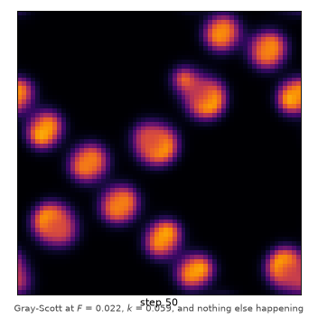

*The system left to itself: spots split, move, merge and disappear, and the grid never settles.
Measurements in `figures/pattern.json`.*

The uniform state $u = 1$, $v = 0$ is a fixed point. It is stable, and that is what makes the next
two sections possible.

### 1.2 The disc-shaped initial condition

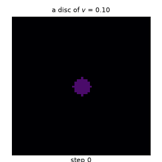
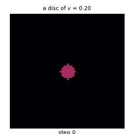

*A disc of $v$ of radius 4 in the uniform state, at two amplitudes, on the same colour scale. At
$v = 0.10$ it is absorbed and the grid returns to $u = 1$, $v = 0$; at $v = 0.20$ it becomes a
spot, still there after 900 steps. Both runs are in `figures/disc.json`.*

Put a disc of $v$ into that uniform state and let the equations run. Either it is absorbed — the
patch decays and nothing marks that it was ever there — or it becomes a **spot**: it climbs
towards $v \approx 0.4$, pulls $u$ down to almost nothing, holds its shape and stays. Which of the
two happens is decided by the disc's amplitude and radius.

Figure 1 measures the threshold: for a disc of each radius, the smallest amplitude of $v$ that
still leaves a spot after 3000 steps.

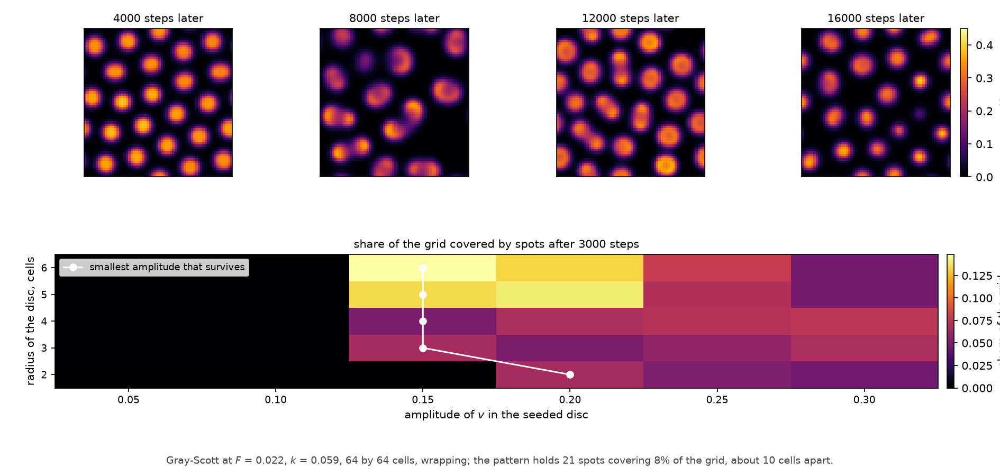

*Figure 1 — the pattern at four moments, and the threshold: the share of the grid covered by
spots after 3000 steps, for a disc of each radius and amplitude, with the smallest amplitude that
survives marked on it.*

The threshold is sharp in amplitude and flat in size: a disc 2 cells across must reach 0.20 in $v$,
every larger disc up to 6 cells only **0.15**. Below 0.15, nothing survives at any size tried.

So a push has a **yes-or-no** outcome: it either changes the pattern for good or does nothing at
all, and §6 measures which one a pushed direction does.

### 1.3 The regime, and why these parameters

$F$ and $k$ choose Gray-Scott's regime. `generate_data.py --explore` walks 24 $(F, k)$ pairs,
integrates each for 8000 steps from the same seeded pattern, and writes a contact sheet: **10
decay** to a uniform grid, **9 fill** with labyrinth, and **5** hold a pattern that keeps changing.
The 19 rejected pairs are unsuitable because a uniform grid or an edge-to-edge labyrinth makes the
prediction close to the identity, so an SAE trained on that layer would describe a near-identity
map.

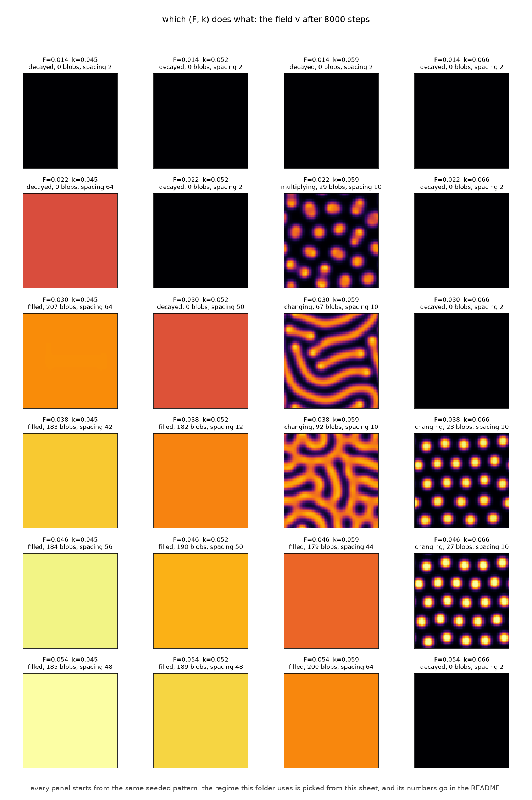

*Figure 2 — the (F, k) plane, one panel per pair, all starting from the same seeded pattern. The
label above each says what happened and what the pattern measures.*

**$F = 0.022$, $k = 0.059$ was picked from that sheet and then checked over a run a hundred times
longer.** It is one of the 5 changing pairs: 21 circular spots covering 0.08 of the grid, about 10
cells apart, appearing and disappearing throughout, so a 100-step prediction is not a copy of the
input.

The regime is also **bistable**, which is what makes §6 answerable. The uniform state $u = 1$,
$v = 0$ is a fixed point, and it is stable: a disturbance below the threshold in §1.2 decays back
to it. A pattern does not decay — once established it sustains itself. Five runs start from the
same 25 discs (radius 3 cells, $u = 0.50$, $v = 0.25$, planted at random offsets on the same
lattice), each integrated for 16000 steps: **four end in the uniform state** — no spots, coverage
0 — and the fifth is the run described above, holding 21 spots. A push can therefore move the
system from one of the two states to the other and leave it there. `make_fig1.py` fixes its seed
and raises if the pattern it drew died.

## 2. The task and the data

The task is to predict the next recorded state: given the state and the state one emulator call
ago, produce the state one call later.

**One call is 100 model steps.** With a single-step call the emulator would only have to reproduce
the integrator's stencil cell by cell and there would be nothing to interpret; at 100 steps a spot
can appear, which depends on more than the two fields at that cell. A call is also **17%** of the
600 steps over which the pattern decorrelates, so each prediction is an extrapolation, not a near
copy of the input.

The data are one 160000-step trajectory cut into three **contiguous blocks in time**, recorded
every 100 steps: 1092 training pairs, 234 for validation and 233 for testing — 4472832, 958464 and
954368 cells. Blocks are contiguous and separated by 2000 steps because neighbouring states share
almost all their pattern, so a random split would put the answer to a test question in the
training set. Each field is standardised by one mean and one standard deviation from the training
block only — $u$: 0.700 ± 0.189, $v$: 0.081 ± 0.100 — one pair for the whole grid, since the
system is the same everywhere.

**How hard is the task?** Repeating the input costs **0.516** and predicting the average field
0.997, in standardised units, so repeating the input is only half as good as knowing nothing.

The test block's coverage runs from 0.013 to 0.204 (mean 0.114), so it holds patterns of different
density rather than copies of one, and a low error on it means the emulator handles states it was
not trained on.

## 3. The emulator

*What to run:*

```bash
../../.venv/bin/python train_emulator.py --data data/gray_scott.npz --model-dir model --figures figures
```

### 3.1 Architecture

The system is a torus, so the emulator is a torus.

* each cell carries a **token** of 32 numbers, and all four blocks are 32 wide;
* an `embed` convolution turns the two fields at the two recorded times — four numbers — into
  that token;
* four residual blocks, each a convolution with **circular** padding, so the bottom row is next to
  the top one and no cell is special;
* the blocks are **dilated** by 1, 2, 4, 8 cells. Dilating instead of stacking is what
  makes a wide window affordable: four blocks reach 15 cells to either side, where
  fifteen blocks of plain 3 × 3 would have been needed;
* the head turns the token back into the two fields, and the prediction is added to the last input
  state, so what the network actually produces is the *change* over the 100 steps.

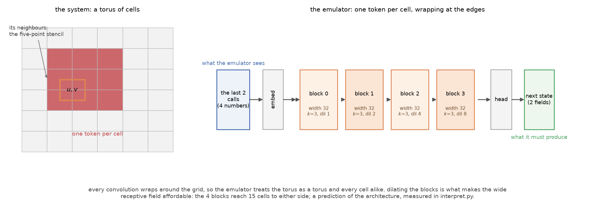

*Figure 3 — the system, and the stack built to imitate it.*

The model has **41762** parameters, trained for 35 epochs in
925 seconds on four CPU threads, keeping the epoch with the best validation
error. §5.1 measures its 15-cell window against the trained network.

### 3.2 One call

On the test block the emulator's error is **0.073** in standardised units (0.0109 in the fields'
own units), against **0.516** for repeating the input and 0.997 for the average field — about
**7 times** better than the trivial forecast it has to beat. The spots peak at $v = 0.4$, so that
error is about 3% of a spot's height.

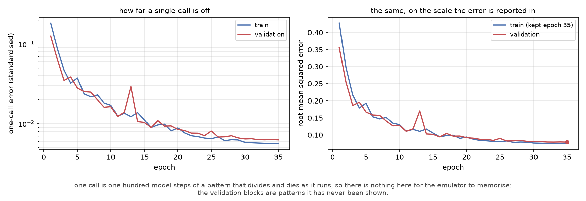

*Figure 4 — training. The validation blocks are pattern states the emulator was never shown.*

### 3.3 Run on its own

The emulator is trained on one call and judged over many: it is run freely, its own prediction
feeding the next call, against the true system from the same states.

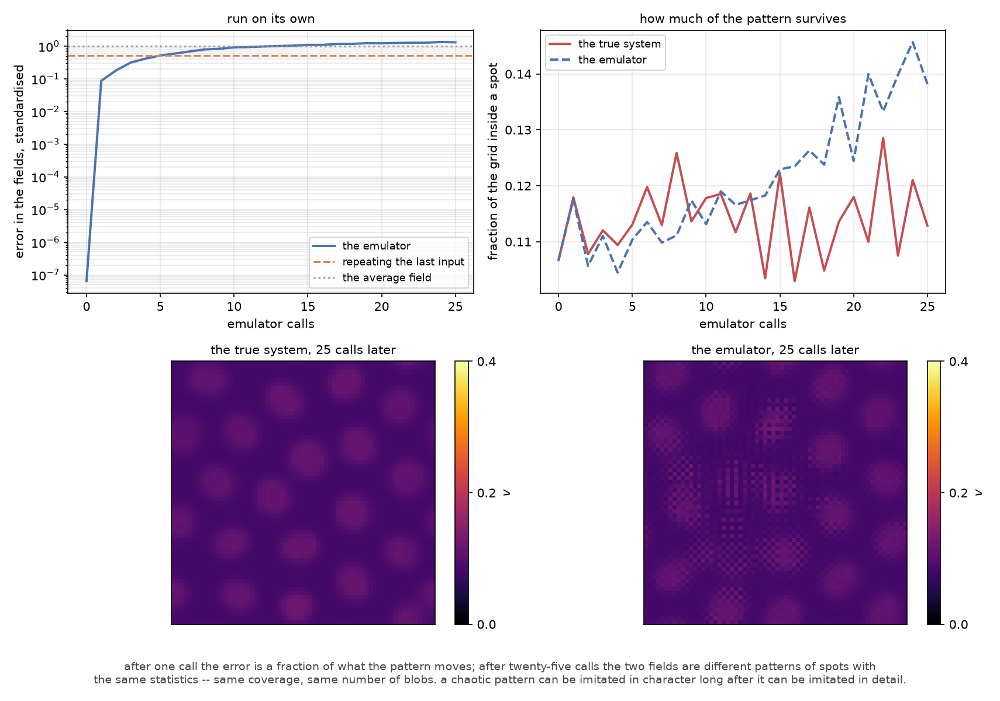

*Figure 5 — what a free rollout does. Top left: the error against the two trivial forecasts, on a
log scale. Top right: how much of the pattern is left, in coverage and in blob count. Bottom: the
true fields and the emulator's, 25 calls later.*

The error grows from 0.088 after one call to 0.921 after 10 and 1.318 after 25, and by call 25 the
two fields are different patterns of spots. The coverage and the blob count still
match where the fields do not: after 10 calls the emulator's coverage is 0.113 against the true
0.118, and it has 32 blobs against 30. A chaotic pattern can be reproduced statistically long
after its individual spots can be reproduced, and it is that population of spots the rest of this
folder is about.

## 4. The sparse autoencoder

*What to run:*

```bash
../../.venv/bin/python train_sae.py --data data/gray_scott.npz --model-dir model --figures figures
```

An SAE is a second, separate network with one job: rebuild a token. It has 512 **directions**,
each as long as a token; for each token it scores every direction, keeps the 16 with the largest
scores, sets the rest to exactly zero, and adds the survivors back up. Training makes that sum as
close to the original token as possible. It never sees the grid, the equations, the next state or
any label.

Sparsity is the only pressure on the directions: a direction earns its place only by being worth
adding to a token, 16 at a time, so a direction that mixes several quantities is at a disadvantage
against one that carries a single quantity.

Two quantities bound what the dictionary can do, and both are measured:

* **Reconstruction** — how much of the token comes back. A dictionary that cannot rebuild the
  token is not describing the layer. This one rebuilds **0.996** of the training tokens and
  **0.996** of tokens from a block it never saw.
* **Principal dimension** — how many directions the token distribution itself needs before 95% of
  its variance is accounted for: **8 of 32** for 95%, 18 for 99%. This bounds any dictionary on
  this layer: a quantity spread over those 8 directions cannot sit in one of them.

The layer is `blocks.2`, the third of four. A token there has passed through blocks reaching 1, 2
and 4 cells, so it sees a 15 × 15 window — wide enough to hold a whole spot with its
surroundings.

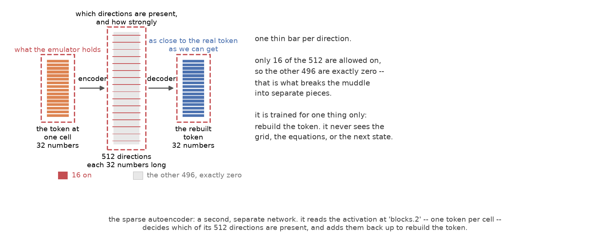

*Figure 6 — a second, separate network that reads one layer and rebuilds it. It never sees the
grid, the equations, or the next state.*

The dictionary was trained on 1228800 tokens and checked on 245760 held out, in
1070 seconds; 1 of the 512 directions never fires.

## 5. What the tokens mean

*What to run:*

```bash
../../.venv/bin/python interpret.py --data data/gray_scott.npz --model-dir model --figures figures
```

### 5.1 The receptive field, measured

The architecture says a token at this layer can be affected by the 7 cells to either
side and by no others. That is checkable: perturb the fields at **one cell** and measure how much
the token changes at every other cell.

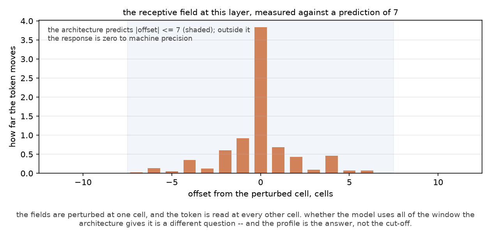

*Figure 7 — how far from the perturbed cell the token still changes.*

Inside the window the token changes by 0.524 on average (Euclidean norm); outside it the change is
**0.00e+00**, exactly zero. The support follows from the architecture, and the trained network
matches it to machine precision.

### 5.2 What one direction holds

The quantities the equation is built from, one number per cell, each paired with that cell's own
token. For each, three things are measured: the best *single* latent, all 512 read jointly, and
the layer's own numbers, which is the ceiling. The best single latent is chosen on one half of the
cells and scored on the other, so the number quoted is not the largest of 512 reported on the
cells that chose it.

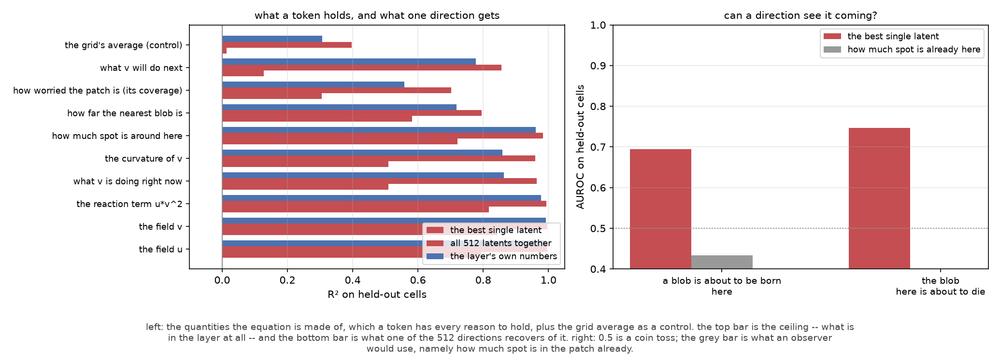

*Figure 8 — left: the nine physical quantities and the control, each with the three read-outs
beside it. Right: whether a direction reads an event before it happens, against how much spot is
already in the patch.*

The best single latent reaches **0.842** on *the field v* (latent 9). No non-control quantity
falls below **0.128**, while the layer holds the same quantities at R² **0.558–0.992**. The
control is separate: the layer holds the grid's average at 0.307, and one direction carries 0.013
of it.

So the physics is present in the layer, and one direction carries only part of it: with 8 of 32
directions needed for 95% of the variance, no single direction can carry a quantity spread over
the rest.

### 5.3 A direction that sees an event coming

The quantities above are properties of the present state. A blob appearing and a blob disappearing
happen in the next state, so a direction that ranks them is carrying information about the future
rather than about the present. Two labels, taken from the next state and applied to the cell:
*a blob is about to be born within a few cells of here*, and *the blob here is about to die*.

They are binary and rare, so they are scored by AUROC, the chance a positive cell is ranked above
a negative one, and the reference is not 0.5 but what an observer would use: how much spot is
already in the patch.

**0.015** of cells are within a few cells of a blob that does not yet exist, and the best direction
separates those at **0.694**, against 0.434 for how much spot is already in the patch. A blob
disappearing is commoner (0.051 of cells) and read better: **0.747** against 0.165.

## 6. The push

*What to run:*

```bash
../../.venv/bin/python perturb.py --data data/gray_scott.npz --model-dir model --figures figures
```

This section tests the causal question. Everything above describes what the SAE found; this asks
whether any direction acts as a causal control on the model, and whether the resulting change is
what the equations would produce.

### 6.1 Which directions matter

Every one of the 512 directions is pushed at every cell by 0.25 of the token's own size, and the
change in the predicted next state is recorded. Random directions of the same size are pushed the
same way, as the control.

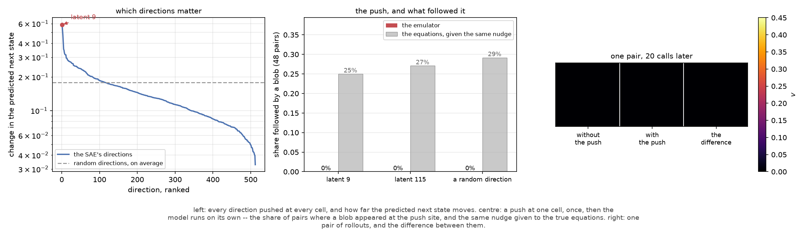

*Figure 9 — left: every direction pushed, ranked, against random directions of the same size.
Centre: a push at one cell, once, then what followed it — in the model, and in the equations.
Right: one pair of rollouts, and the difference between them.*

The strongest direction changes the predicted next state by 0.587 (RMS), the median direction by
0.128, and the weakest by 0.033 — a factor of 18 between the ends. Random directions average
0.178, and the best of the 64 reaches 0.405, so the strongest direction changes the prediction 1.4
times as much as any random one.

### 6.2 One push, at one cell, once

The push is applied on the first call only, and from there the model runs on its own. The question
is the one §1.2 makes answerable: did a blob appear where there was none?

It is asked **paired** — the same state, the same cell, with and without the push — so that a blob
which was going to appear anyway is not credited to the push. In none of the 48 pairs did a blob
appear at the push site: not for the strongest direction, not for the weakest, not for a random
one of the same size. At this push size, the strongest direction of the dictionary does not
nucleate a spot in the model.

The controls make the proportion interpretable; a proportion alone would not be, since in an
excitable system a blob can appear without any push at all.

### 6.3 The same nudge, given to the equations

The equations cannot be given a change to the emulator's activations, but the difference the push
makes to the predicted field *is* a perturbation of the two fields. That can be measured: its
shape, its size, and what the **true** system does when it is added to the real state and
integrated for the same 20 calls.

The nudge a push is equivalent to has a peak of 0.4839 in $v$, three times the 0.15 that a disc
needs to survive (§1.2). Given that nudge, the true system grows a blob in **25%** of cases,
against 29% for the random direction's nudge: the strongest direction of the dictionary is no
better than a random perturbation of the same size.

## 7. What this means

Three things can be said.

**The regime makes the causal question well posed.** The threshold in §1.2 and the second
long-lived state in §1.3 are what make the question answerable: in a single chaotic attractor
every push perturbs a trajectory and none changes anything permanently, so *did the push do
something?* would have no yes-or-no answer.

**The dictionary describes the layer but is not a basis for the physics.** It rebuilds the token
almost exactly (0.996), and all 512 directions together recover the layer's physical content. A
single direction, however, recovers 0.128 to 0.842 of the non-control quantities present in the
layer at R² 0.558–0.992 — as §4 predicted, since the token needs 8 directions for 95% of its
variance.

**Causal control is distinct from description.** The quantities in §5.2 are read from the
activations; the push in §6 modifies them. §6.2 finds no nucleation in the model for any
direction, and §6.3 finds no advantage over a random perturbation of the same size, so neither
supports the inference that a direction which reads local spot density and changes the forecast
when pushed is the mechanism by which the model grows spots.

### 7.1 Limitations

* **One regime, one layer, one size of push.** Everything here is $F = 0.022$, $k = 0.059$,
  `blocks.2`, and a push of 0.25 of the token's size. §1.3 shows that at a neighbouring $(F, k)$
  the pattern freezes and there is nothing to push; the size of the push was not swept.
* **The pairing controls for the model, not for the world.** The paired contrast removes blobs that
  were going to appear anyway *in the model's own rollout*. It cannot remove the possibility that
  the emulator's error and the push interact, and it says nothing about whether a real Gray-Scott
  experiment would respond to a nudge applied to a network.
* **The events are defined by a detector.** A blob is the brightest cell of a connected region
  above a threshold, found by non-maximum suppression. A different detector would give different
  base rates in §5.3, which is why each AUROC is reported next to its reference.
* **The nudge is the emulator's, not an experiment's.** §6.3 adds the field difference the push
  makes to the true state, which is a translation: the push acts on a network's activations, and
  the equations are only ever given the resulting change in the field.

## 8. Files

| file | what it does |
|---|---|
| `generate_data.py` | simulates Gray-Scott, walks the (F, k) plane to pick a regime, builds the split dataset |
| `train_emulator.py` | the circular-convolution emulator: architecture figure, training, one-call metrics, free rollouts against two trivial forecasts |
| `train_sae.py` | the TopK SAE on one layer's tokens: training, reconstruction, firing rates, principal dimension |
| `interpret.py` | the receptive field, the quantities a token holds, and whether a direction can see a blob being born |
| `perturb.py` | ranks the directions, then pushes one at one cell and asks what followed, in the model and in the equations |
| `make_fig1.py` | the system figure and the measurements that go with it: the pattern, the threshold map, and the two long-lived states |
| `animate.py` | the moving pictures: the system running, each disc-shaped initial condition, the emulator's own rollout, and one push |

Artifacts: `data/gray_scott.npz`; `model/emulator.pt` with `metrics.json` and `history.json`;
`model/sae.pt` with `sae_metrics.json` and `sae_history.json`; `model/interpret.json`;
`model/perturb.json`; `model/system.json`; `figures/regimes.json`; `figures/pattern.json` and
`figures/disc.json`; `figures/*.png` and `figures/*.gif`.

`interpret.py` and `perturb.py` read `model/sae.pt`; `make_fig1.py` regenerates the system from
the dataset settings. Environment: NumPy, PyTorch, Matplotlib (`requirements.txt`), single
process, CPU only. Timings on four CPU threads: emulator 925 s, SAE 1070 s, `interpret.py`
2 min, `perturb.py` 3 min, other scripts under 1 min.
